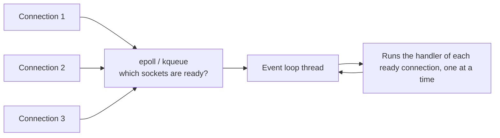
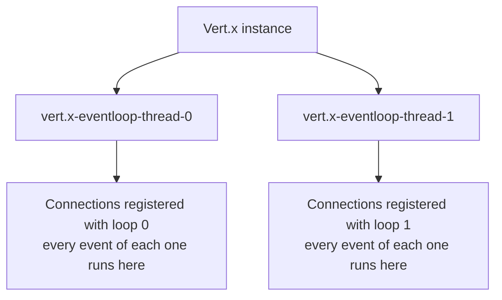
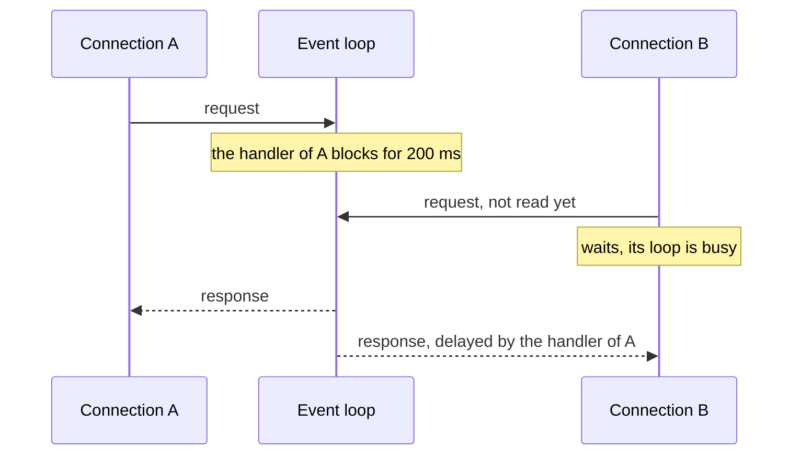
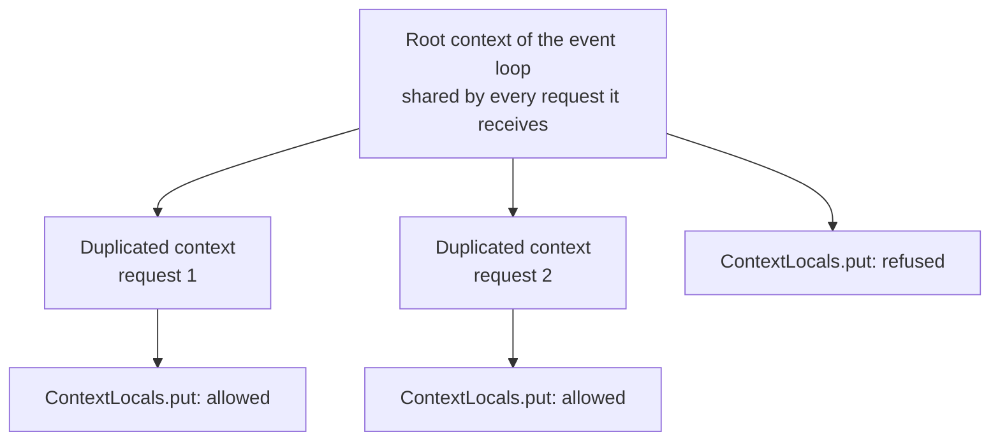
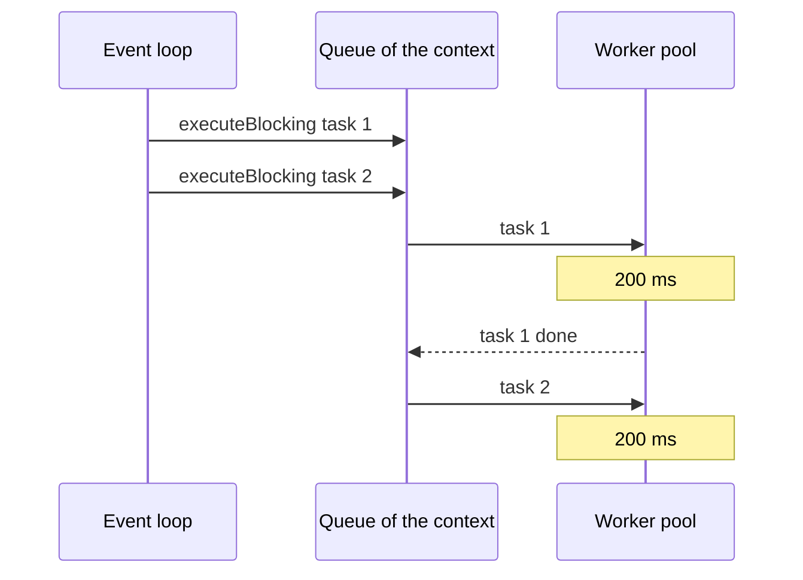

I configured Quarkus with two event loops and fired 24 requests at it at the same instant. Then I asked each response which thread had served it:

```java
@QuarkusTest
@TestProfile(EventLoopsTest.TwoEventLoops.class)
class EventLoopsTest {

    @Test
    void everyNonBlockingRequestIsServedByOneOfTheConfiguredEventLoops() {
        Set<String> threads = Concurrently.get(24, "/event-loops/current").stream()
                .map(response -> response.jsonPath().getString("thread.name"))
                .collect(Collectors.toSet());

        assertThat(threads, hasSize(lessThanOrEqualTo(2)));
        assertThat(threads, everyItem(startsWith("vert.x-eventloop-thread-")));
    }
}
```

The test passes. Twenty-four requests in flight, at most two thread names. If you come from Spring MVC or classic Jakarta EE, that is strange: you are used to one thread per request, and to a pool of two hundred of them.

This is the first part of a series about **who runs your code in Quarkus**. Before talking about `@Blocking`, Mutiny or virtual threads, it starts below Quarkus, in the two layers everything else is built on: Netty and Vert.x. Everything later in the series is a consequence of what happens here.

## The lab

Every claim in this series is backed by a test in a public demo: [omatheusmesmo/demos, `quarkus/reactive-core`](https://github.com/omatheusmesmo/demos/tree/main/quarkus/reactive-core). Each endpoint returns the thread that served it, and each test asserts on that thread, not only on the response body. It runs on Quarkus 3.40.1 and Java 25, and every test in this article also passes on Quarkus 4.0.0.Beta1; section 8 tells what it took to get there.

With the threading lab running, one command shows the whole series in three lines:

```text
$ make threads MODULE=labs/threading
PATH                     THREAD                               VIRTUAL  EVENTLOOP  DUPLICATED
/dispatch/sync           executor-thread-1                    false    false      true
/dispatch/uni            vert.x-eventloop-thread-3            false    true       true
/dispatch/virtual        quarkus-virtual-thread-0             true     false      true
```

Three endpoints, three kinds of thread. This article is about the second line.

## 1. One thread, many connections

The idea is older than Java's non-blocking I/O. Instead of parking a thread on every socket while it waits for bytes, you ask the operating system to tell you which sockets are ready (epoll on Linux, kqueue on macOS), and a single thread loops over those notifications and runs the code interested in each one. That loop is the **event loop**, and the design is the **reactor pattern**.



[Netty](https://netty.io/), the network library under Vert.x and therefore under Quarkus, is built around it. The Javadoc of its `EventLoop` is two sentences long, and both matter:

> Will handle all the I/O operations for a Channel once registered.
>
> One EventLoop instance will usually handle more than one Channel but this may depend on implementation details and internals.

A `Channel` is a connection. Once a connection is registered with an event loop, that event loop handles all of its I/O, and each event loop serves many connections. The Netty thread model adds the rule that makes this safe: every inbound event of a channel is fired from the thread that performs I/O for that channel. Your code that reacts to a request always runs on the same thread that read it.

That explains the opening test. Each of the 24 connections was registered with one of the two event loops, and from then on every byte of it went through that loop.

## 2. From reactor to multi-reactor

A single event loop has an obvious limit: one thread runs on one core. Node.js has exactly this shape and scales across cores by starting several processes.

[Vert.x](https://vertx.io/), the toolkit Quarkus runs on, takes a different route. Its core manual calls it the *Multi-Reactor Pattern*:

> Instead of a single event loop, each Vertx instance maintains *several event loops*.

and adds the guarantee that makes it usable:

> Even though a Vertx instance maintains multiple event loops, any particular handler will never be executed concurrently, and in most cases (with the exception of worker verticles) will always be called using the *exact same event loop*.

When Quarkus serves an HTTP request, there is a Vert.x HTTP server underneath, running on those event loops. The same is true for messaging, gRPC and almost every kind of I/O in Quarkus.



That is the shape of the opening test: 24 connections spread over two loops, each connection staying on the loop it was registered with.

## 3. How many event loops does Quarkus start?

Here the documentation disagrees with itself. The Vert.x core manual says, in one section, that the number of event loops is chosen "based on the number of available cores", and, in another, that a Vert.x instance maintains N event loop threads "where N by default is core*2". Both sentences are still in the manual for Vert.x 5.1.

For Quarkus, neither matters, because Quarkus does not use the Vert.x default. The Quarkus guide says the pool size "matches the number of CPUs detected on the system", and the code in `VertxCoreRecorder` (Quarkus 3.40.1) says a little more:

```java
private static int calculateDefaultIOThreads() {
    //we only allow one event loop per 10mb of ram at the most
    //it's hard to say what this number should be, but it is also obvious
    //that for constrained environments we don't want a lot of event loops
    //lets start with 10mb and adjust as needed
    //We used to recommend a default of twice the number of cores,
    //but more recent developments seem to suggest matching the number of cores 1:1
    //being a more reasonable default. It also saves memory.
    int recommended = ProcessorInfo.availableProcessors();
    long mem = Runtime.getRuntime().maxMemory();
    long memInMb = mem / (1024 * 1024);
    long maxAllowed = memInMb / 10;

    return (int) Math.max(2, Math.min(maxAllowed, recommended));
}
```

So the default is **one event loop per core, never more than one per 10 MB of heap, and never fewer than two**. A container that sees 32 cores but has a 256 MB heap starts 25 event loops, not 32 and not 64. You can override it with `quarkus.vertx.event-loops-pool-size`, which is what the opening test does through a test profile.

For comparison, the worker pool that serves blocking code defaults to `max(8 * cores, 200)` threads. Few event loops, many workers: the two pools are sized for opposite kinds of work.

## 4. The golden rule, and its arithmetic

A handful of threads serving thousands of connections only works under one condition, which the Vert.x manual states in bold: **don't block the event loop**. If a handler blocks, that event loop cannot serve any other connection registered with it until the handler returns. Block every event loop and the application stops.

The manual lists what counts as blocking: `Thread.sleep()`, waiting on a lock or a monitor (`synchronized`), a long database operation, a complex calculation, spinning in a loop. And then it answers the question everybody asks, "how long is too long?", with arithmetic instead of a number:

> If you have a single event loop, and you want to handle 10000 http requests per second, then it's clear that each request can't take more than 0.1 ms to process, so you can't block for any more time than that.

The rule is not "never do anything slow". It is a budget: the time you spend on the event loop is time every other connection on that loop waits.



When you break it, Vert.x tells you. A watchdog, the blocked thread checker, logs a warning with a stack trace when an event loop does not return in time:

```text
Thread vertx-eventloop-thread-3 has been blocked for 20458 ms
```

In Quarkus, the threshold is `quarkus.vertx.max-event-loop-execute-time` and the warning delay is `quarkus.vertx.warning-exception-time`. Both default to two seconds, which is a detector for disasters, not a budget. Your real budget is the arithmetic above.

## 5. The safety net Quarkus adds

Quarkus goes one step further than a warning: in some cases it refuses to block. The demo has an endpoint that waits for a `Uni` on the event loop:

```java
@GET
@Path("/event-loop")
@NonBlocking
public Observed<String> onEventLoop() {
    return Observed.of(slowResult().await().atMost(TIMEOUT));
}
```

It never waits. Mutiny asks Quarkus whether the current thread may be blocked, and on an event loop the answer is no, so `await()` throws immediately:

```java
public static IllegalStateException currentThreadCannotBeBlocked() {
    return new IllegalStateException("The current thread cannot be blocked: " + Thread.currentThread().getName());
}
```

The test asserts exactly that: a `500` whose message contains "cannot be blocked". The same `await()` in a method annotated with `@RunOnVirtualThread` returns normally, which is a story for part 4.

Other extensions have their own nets. Hibernate ORM, called from the event loop, fails with "You have attempted to perform a blocking operation on a IO thread". They are worth knowing because they turn a silent latency problem into a loud error during development.

## 6. Every request gets a context

There is one more piece of the Vert.x core that the rest of the series leans on. Every time Vert.x calls a handler, it does so inside a `Context`:

> Usually a context is an *event-loop context* and is tied to a specific event loop thread. So executions for that context always occur on that exact same event loop thread.

Quarkus refines this with **duplicated contexts**: one per unit of processing (an HTTP request, a Kafka message), attached to an event loop but not shared with other requests. Every endpoint in the demo reports `duplicatedContext=true`, including the ones that run on workers and virtual threads. This is where Quarkus keeps per-request state, such as the CDI request scope and tracing data, without `ThreadLocal`. Part 2 shows what that changes in practice, including a case where a `ThreadLocal` seems to work and why.

The event loop context those duplicates come from, the **root context**, is shared by every request it receives. Storing request data there would leak it into unrelated requests, so the `ContextLocals` API that Quarkus ships refuses it with an `UnsupportedOperationException`: "Access to Context Locals are forbidden from a 'root' context as it can leak data between unrelated processing". The lab has an endpoint that tries anyway, and `ContextTest` expects the refusal.



## 7. Leaving the event loop, and the queue nobody expects

Real applications have blocking code: JDBC, file systems, libraries with synchronous APIs. Vert.x does not pretend otherwise. Its manual says "the real world is not like that. (Have you watched the news lately?)" and offers `executeBlocking`, which runs code on a worker thread and hands the result back as a future.

There is a detail in that section of the manual that is easy to miss:

> By default, if executeBlocking is called several times from the same context (e.g. the same verticle instance) then the different executeBlocking are executed _serially_ (i.e. one after another).

The demo turns that sentence into a test. An endpoint submits two blocking tasks of 200 ms from the same context and reports how many ran at the same time:

```java
private Uni<Observed<Integer>> peakOfTwoTasks(boolean ordered) {
    ConcurrencyTracker tracker = new ConcurrencyTracker();
    Context context = vertx.getOrCreateContext();
    return Uni.combine().all()
            .unis(submit(context, tracker, ordered), submit(context, tracker, ordered))
            .with((first, second) -> Observed.of(tracker.peak()));
}

private static Uni<String> submit(Context context, ConcurrencyTracker tracker, boolean ordered) {
    return Uni.createFrom().completionStage(() -> context
            .executeBlocking(() -> tracker.track(ExecuteBlockingResource::blockForAWhile), ordered)
            .toCompletionStage());
}
```



With `ordered = true`, the default, the peak is **1**: the second task waits for the first, even with idle workers available. With `ordered = false`, the peak is **2**. If you offload blocking work from a handler and wonder why it does not run in parallel, this is the first thing to check.

## 8. What Quarkus 4 changes here

Quarkus 4.0.0.Beta1 moves to Vert.x 5.1.8 and Netty 4.2.18. I compared the Vert.x core manual of 4.5 and 5.1 line by line: the sections on the reactor, the golden rule, the context and running blocking code did not change. What changed is around them: verticles now return futures (`VerticleBase`), the command line launcher is gone, and timers can be used as futures.

Below Vert.x, Netty 4.2 decouples the event loop from the transport. Instead of a `NioEventLoopGroup` or an `EpollEventLoopGroup`, an event loop group now takes an I/O handler (`NioIoHandler`, `EpollIoHandler`, `IoUringIoHandler`), and io_uring graduates from incubator to a supported transport. Netty 4.2 also makes a new memory allocator the default, which its migration guide says "was also designed from the start to work well with virtual threads". That sentence will matter in part 4.

Then I reran the demo on 4.0.0.Beta1. Every module that uses Quarkus the way an application does (REST, the REST Client, PostgreSQL, Kafka, Redis, the Scheduler) passed with the same outcomes as on 3.40.1. The threading lab, where the tests of this article live, did not even compile at first:

```text
ContextResource.java:[50,13] no suitable method found for putLocal(java.lang.String,java.lang.String)
```

The lab called `Context.putLocal(Object, Object)` on the root context to show the refusal from section 6. Vert.x 5 removed that method: its `Context` now only takes typed `ContextLocal` keys. The fix was to stop calling the Vert.x API directly and use `ContextLocals`, the SmallRye API Quarkus ships on both lines (`smallrye-common-vertx-context` for Vert.x 4, `smallrye-common-vertx5-context` for Vert.x 5). The endpoint now runs it on the root context:

```java
@GET
@Path("/root")
public Uni<Observed<String>> root() {
    Context root = VertxContext.getRootContext(Vertx.currentContext());
    return Uni.createFrom()
            .item(() -> {
                ContextLocals.put(RequestTagFilter.REGULAR.tagKey(), "shared by every request on this event loop");
                return Observed.of("stored on the root context");
            })
            .runSubscriptionOn(task -> root.runOnContext(ignored -> task.run()));
}
```

The same source compiles on both versions, and all 45 tests of the threading lab pass on 3.40.1 and on 4.0.0.Beta1. To check that the test was not passing by accident, I removed the `runSubscriptionOn` line, which leaves the code on the duplicated context: the store succeeded and the test failed, as it should. The refusal survived the upgrade; the API I used to provoke it did not. It is a good reminder of what this series keeps finding: a model can survive an upgrade while one of its APIs does not.

## Conclusion

Under Quarkus, a few event loop threads serve many connections each. Netty binds every connection to one of them, Vert.x runs several of them and calls your handlers on them, and Quarkus sizes them at one per core, capped by memory. The model only holds if handlers return quickly: the budget is arithmetic, not a fixed number, and Quarkus adds safety nets that turn some violations into errors.

What this article left open is the question in the title of the series. If the HTTP request always arrives on an event loop, who decides that a synchronous endpoint runs on `executor-thread-1` instead? Part 2 answers it, rule by rule, and with one rule the Quarkus documentation still describes but the code no longer applies.

## Resources

- [Demo: `quarkus/reactive-core`](https://github.com/omatheusmesmo/demos/tree/main/quarkus/reactive-core), in particular `labs/threading` (`EventLoopsTest`, `AwaitTest`, `ContextTest`, `ExecuteBlockingTest`)
- [Vert.x Core Manual](https://vertx.io/docs/vertx-core/java/): Reactor and Multi-Reactor, the Golden Rule, the Context object, Running blocking code
- [Netty user guide for 4.x](https://netty.io/wiki/user-guide-for-4.x.html) and [Netty 4.2 Migration Guide](https://github.com/netty/netty/wiki/Netty-4.2-Migration-Guide)
- [Quarkus reactive architecture](https://quarkus.io/guides/quarkus-reactive-architecture) and [Vert.x reference guide](https://quarkus.io/guides/vertx-reference)
- [Duplicated context, context locals, asynchronous processing and propagation](https://quarkus.io/guides/duplicated-context)
- [Mutiny primer: integration with Quarkus](https://quarkus.io/guides/mutiny-primer)
- Previously on this blog: [Internal messaging in Quarkus with the Event Bus](/en/posts/quarkus-event-bus-consumeevent/) and [Virtual Threads: A Pocket Guide](/en/posts/virtual-threads-pocket-guide/)
