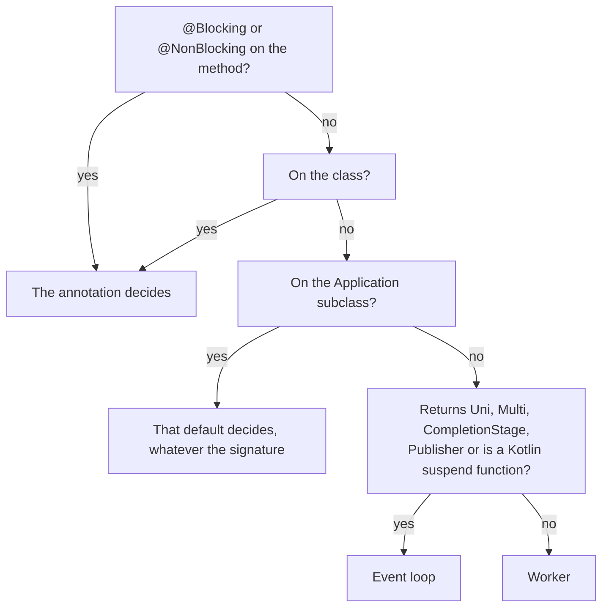
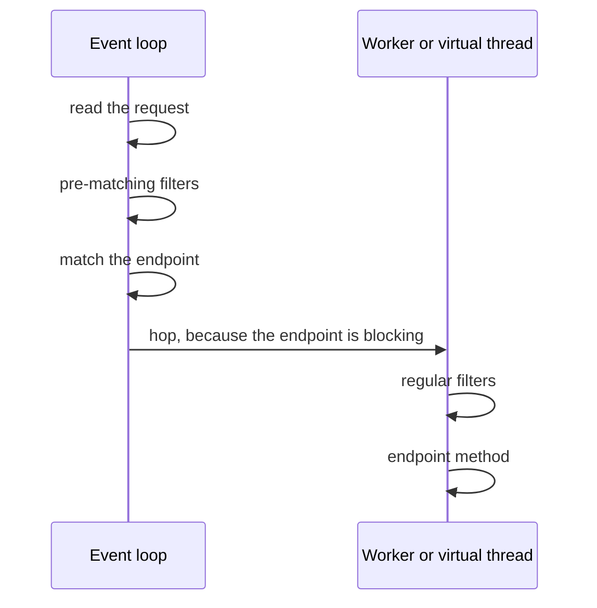

The Quarkus REST guide has a paragraph I had read many times:

> If a method or class is annotated with `jakarta.transaction.Transactional` then it will also be treated as a blocking method. This is because JTA is a blocking technology, and is generally used with other blocking technology such as Hibernate and JDBC.

So I wrote the test that paragraph describes: an endpoint that returns a `Uni`, annotated with `@Transactional`, which should run on a worker thread.

```java
@GET
@Path("/transactional-uni")
@Transactional
public Uni<Observed<String>> transactionalUni() {
    return Uni.createFrom().item(() -> Observed.of("@Transactional with a Uni signature"));
}
```

It never reached a worker. It answered `500`, with this message:

```text
@Transactional cannot start a JTA transaction within a reactive pipeline. If the annotated method is intended to be
blocking, ensure it is executed on a worker thread, for example by annotating it with @Blocking. If the annotated
method is intended to be reactive, consider using Hibernate Reactive, which supports @Transactional in a reactive
context.
```

The paragraph is still in the REST guide for Quarkus 3.40.1, for 4.0.0.Beta1 and on the main branch. The code stopped applying it in March, and the migration guide announced it; only the REST guide was never updated. This article is about that decision, made for every method you write: [part 1](/en/posts/quarkus-event-loop-from-the-ground-up/) showed that every HTTP request arrives on an event loop, and this part shows **who decides which thread runs your code after that**, rule by rule, and where the rules differ between extensions.

## The lab

Same demo as part 1: [omatheusmesmo/demos, `quarkus/reactive-core`](https://github.com/omatheusmesmo/demos/tree/main/quarkus/reactive-core). Every endpoint and consumer reports the thread that ran it, and every test asserts on that thread. Writing this article added four tests, because reading the code turned up behaviour the guides do not describe. Every test cited here passes on Quarkus 3.40.1 and on 4.0.0.Beta1.

## 1. Three answers in five years

Quarkus has answered "which thread runs my endpoint?" three times.

**RESTEasy Classic** always used a worker thread. Simple to reason about, but concurrency is limited by the number of threads.

**RESTEasy Reactive**, introduced in Quarkus 1.11, flipped it: everything ran on the I/O thread, the event loop, and you added `@Blocking` to leave it. Many developers met a wall of text the first time Hibernate ORM ran on an event loop.

The obvious fix would be "blocking by default". Clement Escoffier explained in 2021 why that is not a fix:

> It's as dangerous to call reactive APIs expected to be called on an I/O thread on a worker thread than calling blocking APIs on the I/O thread.

So **Quarkus 2.2** introduced the third answer, still in place today: the thread is chosen from the method signature. In his words, "synchronous methods default to worker threads, and asynchronous methods default to I/O threads, except if explicitly stated otherwise". RESTEasy Reactive has since been renamed Quarkus REST, but the rule is the same.

## 2. A decision made at build time

The choice is not made when the request arrives. It is made during the build, in `EndpointIndexer`, the class that turns your resource classes into Quarkus REST metadata. Here is the end of `isBlocking` in Quarkus 3.40.1:

```java
if (defaultValue == BlockingDefault.BLOCKING) {
    return true;
} else if (defaultValue == BlockingDefault.RUN_ON_VIRTUAL_THREAD) {
    return true;
} else if (defaultValue == BlockingDefault.NON_BLOCKING) {
    return false;
}
return doesMethodHaveBlockingSignature(info);
```

Before reaching those lines, the method looks for `@Blocking` and `@NonBlocking`, first on the method, then on the class. If both are present at the same level, the build fails. If they are on different levels, the method wins. The `defaultValue` comes from your `jakarta.ws.rs.core.Application` subclass: annotate it with `@Blocking` or `@NonBlocking` and, as the guide puts it, "all endpoints without an annotation will now follow the default, no matter their method signature".

Only when none of that applies does the signature matter. The check is delegated to scanners, and the one for the standard types is short:

```java
return returnTypeName.equals(COMPLETION_STAGE) || returnTypeName.equals(COMPLETABLE_FUTURE) ||
        returnTypeName.equals(UNI) || returnTypeName.equals(MULTI) || returnTypeName.equals(REST_MULTI) ||
        returnTypeName.equals(PUBLISHER) || returnTypeName.equals(LEGACY_PUBLISHER);
```

The Kotlin extension adds `suspend` functions through its own scanner, and any extension can declare another non-blocking return type with a `NonBlockingReturnTypeBuildItem`. Everything else is synchronous and goes to a worker.



Because the decision is part of the endpoint's metadata, nothing has to work it out per request: the endpoint already knows where it runs.

## 3. Seven endpoints, three kinds of thread

The demo has one endpoint per rule, and `DispatchTest` asserts on the thread each one reports:

| Endpoint | Signature | Thread |
|---|---|---|
| `/dispatch/sync` | `Observed<String> sync()` | worker, `executor-thread-*` |
| `/dispatch/uni` | `Uni<Observed<String>> uni()` | event loop, `vert.x-eventloop-thread-*` |
| `/dispatch/blocking-uni` | `@Blocking` and a `Uni` | worker |
| `/dispatch/non-blocking` | `@NonBlocking` and a synchronous signature | event loop |
| `/dispatch/virtual` | `@RunOnVirtualThread` and a synchronous signature | virtual thread, `quarkus-virtual-thread-*` |
| `/dispatch/virtual-uni` | `@RunOnVirtualThread` and a `Uni` | virtual thread |
| `/dispatch/transactional-uni` | `@Transactional` and a `Uni` | event loop, then `500` |

The tests also check that the endpoints on a worker, on the event loop and on virtual threads all run on a duplicated context. That is the per-request context from part 1, and it matters again in section 6.

The `@NonBlocking` row deserves a word. Why keep a synchronous method on the event loop? Because the hop to a worker has a cost. The Quarkus team measured in 2021 that `@Blocking` lowered maximum throughput by about 30% in their benchmarks, a cost that shrinks as the method takes longer. For a method that only does fast, non-blocking work, the hop costs more than the work.

## 4. The rule that only lives in the REST guide

Back to `@Transactional`. In March 2026, [quarkusio/quarkus#51063](https://github.com/quarkusio/quarkus/pull/51063), "Support @Transactional for Hibernate Reactive", was merged for Quarkus 3.35. Among many other changes, it removed two lines from the method shown in section 2:

```java
} else if (transactional != null) {
    return true;
}
```

The reason is in the title. `@Transactional` now also starts reactive transactions with Hibernate Reactive, so a `Uni` method with `@Transactional` is a legitimate reactive method that must stay on the event loop. Sending it to a worker would be the mistake Escoffier warned about, in the other direction.

The consequence is what the opening test shows. Without Hibernate Reactive, a `Uni` endpoint with `@Transactional` stays on the event loop, and the JTA interceptor refuses to start a transaction there. The failure is loud, and the message names both ways out: `@Blocking` if the method is meant to block, Hibernate Reactive if it is meant to be reactive. If you have a `Uni` endpoint that relied on `@Transactional` to reach a worker on a version before 3.35, this is the error you get after the upgrade. The change was announced: the [migration guide for 3.35](https://github.com/quarkusio/quarkus/wiki/Migration-Guide-3.35) has a section titled "Methods annotated with `@Transactional` are no longer automatically considered blocking by Quarkus", with the same advice as the error, "If a method is blocking but returns a `Uni<T>`, it requires an explicit `@Blocking` annotation". The REST guide is the one place that still says the opposite.

## 5. `@RunOnVirtualThread`, the third answer

Virtual threads add a third destination, and the virtual thread guide sets a condition:

> In the case of Quarkus REST, this annotation can only be used on endpoints annotated with @Blocking or considered blocking because of their signature.

The code is more permissive. In `isRunOnVirtualThread`, the case of a method that is not blocking reads:

```java
if (!blocking) {
    if (blockingAnnotation != null) {
        return false;
    }
    if (nonBlockingAnnotation != null) {
        throw new DeploymentException(
                "Method '" + info.name() + "' of class '" + info.declaringClass().name()
                        + "' is considered a non blocking method. @RunOnVirtualThread can only be used on " +
                        " methods considered blocking");
    }
    return true;
}
```

The build only fails when `@RunOnVirtualThread` meets an explicit `@NonBlocking`. On a method that is non-blocking because it returns a `Uni`, it returns `true`, and the `/dispatch/virtual-uni` test confirms it: the method runs on a virtual thread. What matters here is that the guide describes a stricter rule than the one the code enforces, and the code looks deliberate: when [quarkusio/quarkus#55389](https://github.com/quarkusio/quarkus/pull/55389) fixed a related error in 3.39.1, its author described `@RunOnVirtualThread` as "already handled as blocking in the actual code for resteasy". A `Uni` method with it behaves like a `Uni` method with `@Blocking`, on a virtual thread instead of a worker. That only pays off if the method blocks before it returns the `Uni`; otherwise it buys the hop of section 3 for nothing.

The threads themselves are easy to spot in logs and thread dumps: Quarkus names them `quarkus-virtual-thread-` followed by a number, and `quarkus.virtual-threads.name-prefix` changes the prefix.

## 6. Your filter runs where your endpoint runs

Now the `ThreadLocal` that part 1 promised. The virtual thread guide says that data written in the duplicated context by filters and interceptors is available in the method "(even if the filters and interceptors are not run on the virtual thread)", and then warns: "However, thread locals are not propagated."

The demo has a request filter that stores a header twice, in the duplicated context with `ContextLocals` and in a plain `ThreadLocal`, and records the name of the thread it ran on:

```java
@ServerRequestFilter
public void tag(ContainerRequestContext request) {
    REGULAR.store(request.getHeaderString(HEADER));
}
```

```java
void store(String tag) {
    if (tag == null) {
        threadTag.remove();
        return;
    }
    ContextLocals.put(tagKey, tag);
    ContextLocals.put(threadKey, Thread.currentThread().getName());
    threadTag.set(tag);
}
```

Three endpoints, one per model, read both values back. In all three, the `ThreadLocal` arrives, and `ContextTest` shows why: the filter ran on the same thread as the endpoint, the event loop for the non-blocking one, a worker for the synchronous one and **the same virtual thread** for the `@RunOnVirtualThread` one.

The Javadoc of `@ServerRequestFilter` explains it: post-matching filters "are run by RESTEasy Reactive on the same thread as the Resource Method". That makes sense once you remember section 2. The thread depends on the endpoint, and the endpoint is only known after matching, so Quarkus hops to the right thread first and runs the regular filters there.

The same Javadoc names the exception: pre-matching filters "default to running on the event loop", because they run before Quarkus knows the endpoint, and so its thread. The demo has a pre-matching twin of the same filter:

```java
@ServerRequestFilter(preMatching = true)
public void tagBeforeMatching(ContainerRequestContext request) {
    PRE_MATCHING.store(request.getHeaderString(HEADER));
}
```

and two tests that read what it stored, one from a worker and one from a virtual thread:

```java
@Test
void aPreMatchingFilterStaysOnTheEventLoopSoItsThreadLocalNeverReachesTheVirtualThread() {
    tagged().get("/pre-matching/virtual").then().statusCode(200)
            .body("thread", ranOnVirtualThread())
            .body("result.filterThread", startsWith("vert.x-eventloop-thread-"))
            .body("result.contextLocal", is(TAG))
            .body("result.threadLocal", nullValue());
}
```

The filter ran on an event loop, the endpoint on another thread, and only the value stored in the duplicated context made the trip.



So the guide's parenthesis is true for pre-matching filters (and for filters marked `nonBlocking = true`, which ask to stay on the event loop), and not for a regular `@ServerRequestFilter`, which runs on the virtual thread.

## 7. Where a `ThreadLocal` really breaks

A `ThreadLocal` is a bet that nothing changes threads between the write and the read. With a regular filter and a blocking endpoint, the bet wins, which is why code built on it seems to work. It loses as soon as work moves.

A pre-matching filter is one way to lose it. Moving work yourself is another. The `/context/hop` endpoint returns a `Uni`, so it starts on the event loop, where the filter also runs, and then hands the read to a worker with `executeBlocking` on the same context:

```java
@GET
@Path("/hop")
public Uni<Observed<Tags>> hop() {
    Context context = Vertx.currentContext();
    return Uni.createFrom().completionStage(() -> context
            .executeBlocking(() -> Observed.of(Tags.read()))
            .toCompletionStage());
}
```

The test asserts that the read ran on a worker, that the filter ran on an event loop, that the context local arrived and that the thread local is `null`. The duplicated context follows the request across threads; a `ThreadLocal` stays on the thread that wrote it. The duplicated context is also where Quarkus keeps the CDI request scope. Part 3 shows the Mutiny operators that move work in the same way.

## 8. Not only HTTP

The signature rule is not specific to Quarkus REST.

**Messaging.** For Kafka and the other connectors, the Quarkus messaging guide has the same table: "If the method signature is _synchronous_, messages are dispatched on *worker threads* otherwise it defaults to *event-loop*". The demo's consumers confirm it:

| Consumer | Thread |
|---|---|
| `Uni<Void> consume(String)` | event loop |
| `void consume(String)` | worker |
| `@Blocking void consume(String)` | worker |
| `@RunOnVirtualThread void consume(String)` | virtual thread |
| `@Transactional void consume(String)` | worker |

This was not always so. Messaging used to call synchronous consumers on the event loop, and switched to the signature rule in Quarkus 3.10, with [quarkusio/quarkus#39768](https://github.com/quarkusio/quarkus/pull/39768), as the [migration guide for 3.10](https://github.com/quarkusio/quarkus/wiki/Migration-Guide-3.10) announced. The old behaviour is one property away, `quarkus.messaging.blocking.signatures.execution.mode=event-loop`, and a test with that property shows the same `void` consumer back on the event loop. According to the migration guide, the same property also accepts `virtual-thread`. If you learned Reactive Messaging from material written before 3.10, check what it says about this.

Look at the last row of the table. In messaging, `@Transactional` still means blocking. The guide says "the presence of `@Transactional` annotation implies blocking execution", and the code agrees: `QuarkusMediatorConfigurationUtil` still treats `transactionalAnnotation != null` like `@Blocking`. **The same annotation sends a method to a worker in one extension and leaves it on the event loop in another.** For Quarkus REST, the reason is the one in section 4: `@Transactional` became a reactive tool too.

**Scheduler.** `@Scheduled` methods follow the signature as well: in the demo, a `void` job runs on a worker, a job returning `Uni<Void>` runs on the event loop and a `@RunOnVirtualThread` job runs on a virtual thread.

## 9. On Quarkus 4

All the tests in this article pass on Quarkus 4.0.0.Beta1 with the same results, including the `@Transactional` one and the four added for this article. The dispatch rules did not change with Vert.x 5. Neither did the REST guide: the `@Transactional` paragraph is still there.

One rule around these annotations does change, outside the extensions shown here. SmallRye Fault Tolerance 7, which Quarkus 4 brings, no longer accepts `@Blocking` and `@NonBlocking` on guarded methods: the [migration guide for 4.0](https://github.com/quarkusio/quarkus/wiki/Migration-Guide-4.0) says the build marks them invalid, "because these annotations may only be put on 'entrypoints'", and points to MicroProfile's `@Asynchronous` instead of `@Blocking`. If you used `@Blocking` on a method with `@Retry` or `@Timeout`, that is the build error to expect.

## Conclusion

Quarkus decides which thread runs your method at build time. In Quarkus REST, an annotation on the method or class wins, then the default on your `Application` subclass, then the signature: asynchronous types stay on the event loop, everything else goes to a worker, and `@RunOnVirtualThread` sends a method to a virtual thread. Messaging and the Scheduler follow the same signature rule.

The details are where the guides and the code disagree. `@Transactional` stopped meaning "worker" in Quarkus REST in 3.35, but still means it in messaging. `@RunOnVirtualThread` is accepted on a `Uni` endpoint. Regular filters run on the endpoint's thread, which makes a `ThreadLocal` look safe until a pre-matching filter or a thread hop shows that it is not. When the thread matters, put a test on it: it is a one-line assertion, and it is the only way to notice when a rule changes.

All of this is about where a method **starts**. With Mutiny, what happens after that is decided by subscription and by a handful of operators, not by the method. Part 3 is about that: a `Uni` is a recipe, not a result.

## Resources

- [Demo: `quarkus/reactive-core`](https://github.com/omatheusmesmo/demos/tree/main/quarkus/reactive-core): `labs/threading` (`DispatchTest`, `ContextTest`), `integrations/kafka` (`ConsumersTest`, `EventLoopExecutionModeTest`) and `integrations/scheduler` (`JobsTest`)
- [RESTEasy Reactive: to block or not to block](https://quarkus.io/blog/resteasy-reactive-smart-dispatch/), Clement Escoffier, 2021
- [Massive performance without headaches](https://quarkus.io/blog/resteasy-reactive-faq/), Georgios Andrianakis, 2021
- [Quarkus REST guide: execution model](https://quarkus.io/guides/rest#execution-model)
- [Virtual thread support reference](https://quarkus.io/guides/virtual-threads) and [Quarkus Messaging: execution model](https://quarkus.io/guides/messaging)
- [quarkusio/quarkus#51063](https://github.com/quarkusio/quarkus/pull/51063) (`@Transactional` for Hibernate Reactive) and [quarkusio/quarkus#39768](https://github.com/quarkusio/quarkus/pull/39768) (messaging execution mode), and [quarkusio/quarkus#55389](https://github.com/quarkusio/quarkus/pull/55389) (`@RunOnVirtualThread` with blocking endpoints)
- Quarkus migration guides for [3.10](https://github.com/quarkusio/quarkus/wiki/Migration-Guide-3.10), [3.35](https://github.com/quarkusio/quarkus/wiki/Migration-Guide-3.35) and [4.0](https://github.com/quarkusio/quarkus/wiki/Migration-Guide-4.0)
- Previously in this series: [part 1, the event loop from the ground up](/en/posts/quarkus-event-loop-from-the-ground-up/)
