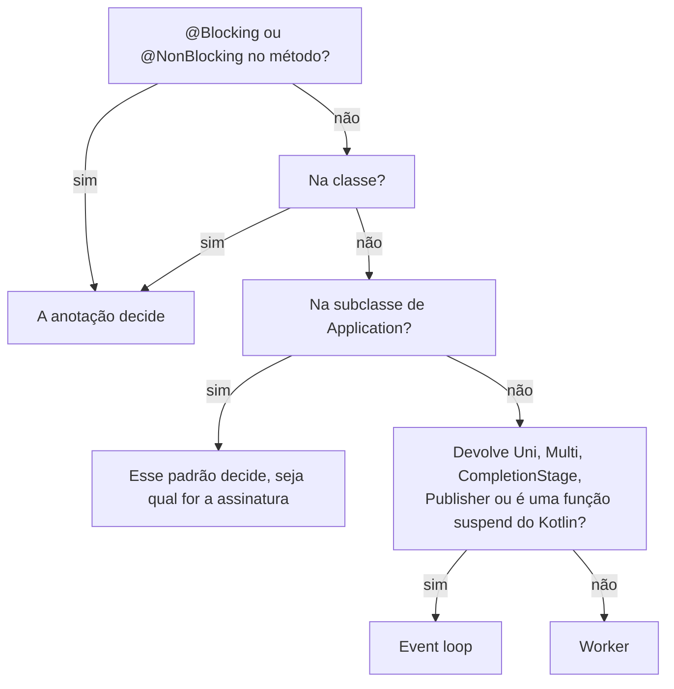
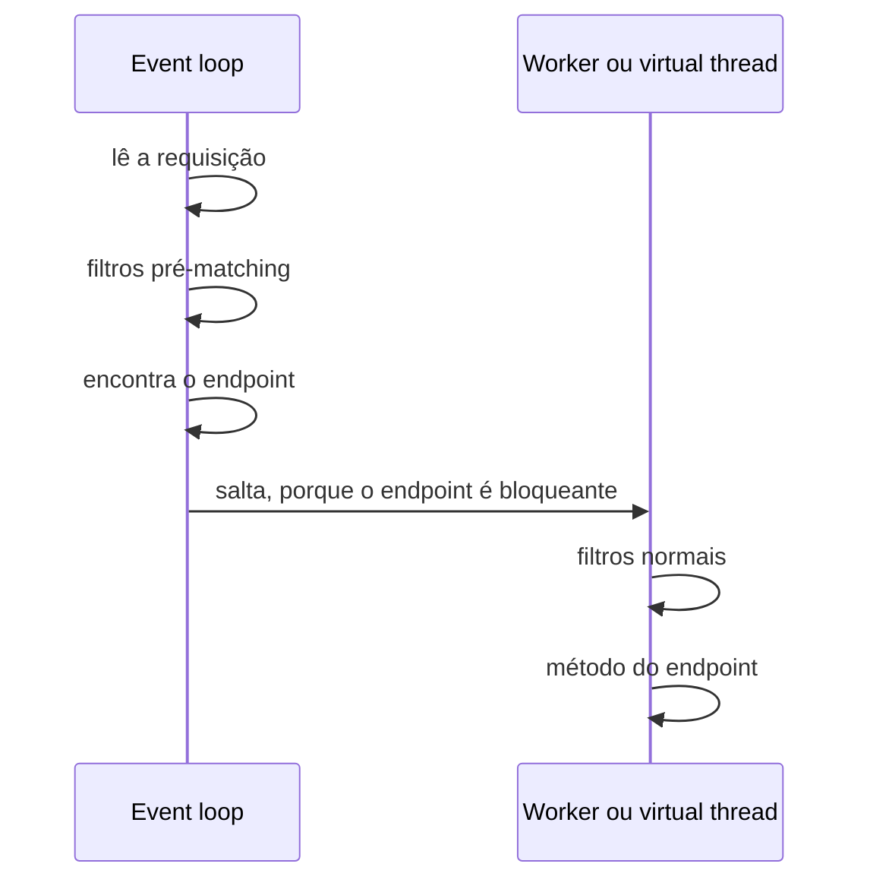

O guia do Quarkus REST tem um parágrafo que eu já tinha lido muitas vezes:

> If a method or class is annotated with `jakarta.transaction.Transactional` then it will also be treated as a blocking method. This is because JTA is a blocking technology, and is generally used with other blocking technology such as Hibernate and JDBC.

Então escrevi o teste que esse parágrafo descreve: um endpoint que devolve um `Uni`, anotado com `@Transactional`, que deveria rodar numa worker thread.

```java
@GET
@Path("/transactional-uni")
@Transactional
public Uni<Observed<String>> transactionalUni() {
    return Uni.createFrom().item(() -> Observed.of("@Transactional with a Uni signature"));
}
```

Ele nunca chegou numa worker. Respondeu `500`, com esta mensagem:

```text
@Transactional cannot start a JTA transaction within a reactive pipeline. If the annotated method is intended to be
blocking, ensure it is executed on a worker thread, for example by annotating it with @Blocking. If the annotated
method is intended to be reactive, consider using Hibernate Reactive, which supports @Transactional in a reactive
context.
```

O parágrafo continua no guia de REST do Quarkus 3.40.1, da 4.0.0.Beta1 e da branch main. O código parou de aplicá-lo em março, e o migration guide anunciou a mudança; só o guia de REST nunca foi atualizado. Este artigo é sobre essa decisão, tomada para cada método que você escreve: a [parte 1](/posts/quarkus-event-loop-do-zero/) mostrou que toda requisição HTTP chega num event loop, e esta parte mostra **quem decide qual thread roda o seu código depois disso**, regra por regra, e onde as regras mudam de uma extensão para outra.

## O laboratório

O mesmo demo da parte 1: [omatheusmesmo/demos, `quarkus/reactive-core`](https://github.com/omatheusmesmo/demos/tree/main/quarkus/reactive-core). Todo endpoint e todo consumer informam a thread que os rodou, e todo teste verifica essa thread. Escrever este artigo acrescentou quatro testes, porque ler o código revelou comportamentos que os guias não descrevem. Todos os testes citados aqui passam no Quarkus 3.40.1 e na 4.0.0.Beta1.

## 1. Três respostas em cinco anos

O Quarkus já respondeu três vezes à pergunta "qual thread roda o meu endpoint?".

O **RESTEasy Classic** sempre usava uma worker thread. Simples de entender, mas a concorrência fica limitada ao número de threads.

O **RESTEasy Reactive**, que chegou no Quarkus 1.11, inverteu isso: tudo rodava na thread de I/O, o event loop, e você colocava `@Blocking` para sair dela. Muita gente conheceu uma parede de texto na primeira vez em que o Hibernate ORM rodou num event loop.

A correção óbvia seria "bloqueante por padrão". Clement Escoffier explicou em 2021 por que isso não corrige nada:

> It's as dangerous to call reactive APIs expected to be called on an I/O thread on a worker thread than calling blocking APIs on the I/O thread.

Então o **Quarkus 2.2** trouxe a terceira resposta, que vale até hoje: a thread é escolhida pela assinatura do método. Nas palavras dele, "synchronous methods default to worker threads, and asynchronous methods default to I/O threads, except if explicitly stated otherwise". O RESTEasy Reactive virou Quarkus REST desde então, mas a regra é a mesma.

## 2. Uma decisão tomada em build time

A escolha não acontece quando a requisição chega. Ela acontece durante o build, no `EndpointIndexer`, a classe que transforma as suas classes de recurso em metadados do Quarkus REST. Este é o final do `isBlocking` no Quarkus 3.40.1:

```java
if (defaultValue == BlockingDefault.BLOCKING) {
    return true;
} else if (defaultValue == BlockingDefault.RUN_ON_VIRTUAL_THREAD) {
    return true;
} else if (defaultValue == BlockingDefault.NON_BLOCKING) {
    return false;
}
return doesMethodHaveBlockingSignature(info);
```

Antes de chegar nessas linhas, o método procura `@Blocking` e `@NonBlocking`, primeiro no método, depois na classe. Se os dois estiverem no mesmo nível, o build falha. Se estiverem em níveis diferentes, o do método vence. O `defaultValue` vem da sua subclasse de `jakarta.ws.rs.core.Application`: anote-a com `@Blocking` ou `@NonBlocking` e, como diz o guia, "all endpoints without an annotation will now follow the default, no matter their method signature".

Só quando nada disso se aplica é que a assinatura importa. A verificação é delegada a scanners, e o dos tipos padrão é curto:

```java
return returnTypeName.equals(COMPLETION_STAGE) || returnTypeName.equals(COMPLETABLE_FUTURE) ||
        returnTypeName.equals(UNI) || returnTypeName.equals(MULTI) || returnTypeName.equals(REST_MULTI) ||
        returnTypeName.equals(PUBLISHER) || returnTypeName.equals(LEGACY_PUBLISHER);
```

A extensão de Kotlin acrescenta as funções `suspend` com um scanner próprio, e qualquer extensão pode declarar outro tipo de retorno não bloqueante com um `NonBlockingReturnTypeBuildItem`. Todo o resto é síncrono e vai para uma worker.



Como a decisão faz parte dos metadados do endpoint, nada precisa descobri-la a cada requisição: o endpoint já sabe onde roda.

## 3. Sete endpoints, três tipos de thread

O demo tem um endpoint por regra, e o `DispatchTest` verifica a thread que cada um informa:

| Endpoint | Assinatura | Thread |
|---|---|---|
| `/dispatch/sync` | `Observed<String> sync()` | worker, `executor-thread-*` |
| `/dispatch/uni` | `Uni<Observed<String>> uni()` | event loop, `vert.x-eventloop-thread-*` |
| `/dispatch/blocking-uni` | `@Blocking` e um `Uni` | worker |
| `/dispatch/non-blocking` | `@NonBlocking` e uma assinatura síncrona | event loop |
| `/dispatch/virtual` | `@RunOnVirtualThread` e uma assinatura síncrona | virtual thread, `quarkus-virtual-thread-*` |
| `/dispatch/virtual-uni` | `@RunOnVirtualThread` e um `Uni` | virtual thread |
| `/dispatch/transactional-uni` | `@Transactional` e um `Uni` | event loop, depois `500` |

Os testes também verificam que os endpoints numa worker, no event loop e em virtual threads rodam todos num duplicated context. É o contexto por requisição da parte 1, e ele volta a importar na seção 6.

A linha do `@NonBlocking` merece um comentário. Por que manter um método síncrono no event loop? Porque o salto para uma worker tem custo. Em 2021, o time do Quarkus mediu que o `@Blocking` reduzia o throughput máximo em cerca de 30% nos seus benchmarks, um custo que diminui quanto mais o método demora. Para um método que só faz trabalho rápido e não bloqueante, o salto custa mais que o trabalho.

## 4. A regra que só existe no guia de REST

De volta ao `@Transactional`. Em março de 2026, o [quarkusio/quarkus#51063](https://github.com/quarkusio/quarkus/pull/51063), "Support @Transactional for Hibernate Reactive", foi integrado para o Quarkus 3.35. Entre muitas outras mudanças, ele removeu duas linhas do método mostrado na seção 2:

```java
} else if (transactional != null) {
    return true;
}
```

O motivo está no título. O `@Transactional` agora também abre transações reativas com o Hibernate Reactive, então um método `Uni` com `@Transactional` é um método reativo legítimo, que precisa ficar no event loop. Mandá-lo para uma worker seria o erro sobre o qual o Escoffier alertou, na direção contrária.

A consequência é o que o teste do começo mostra. Sem Hibernate Reactive, um endpoint `Uni` com `@Transactional` fica no event loop, e o interceptor de JTA se recusa a abrir uma transação ali. A falha é barulhenta, e a mensagem aponta as duas saídas: `@Blocking` se o método deve bloquear, Hibernate Reactive se ele deve ser reativo. Se você tem um endpoint `Uni` que dependia do `@Transactional` para chegar numa worker numa versão anterior à 3.35, este é o erro que aparece depois do upgrade. A mudança foi anunciada: o [migration guide da 3.35](https://github.com/quarkusio/quarkus/wiki/Migration-Guide-3.35) tem uma seção chamada "Methods annotated with `@Transactional` are no longer automatically considered blocking by Quarkus", com o mesmo conselho do erro, "If a method is blocking but returns a `Uni<T>`, it requires an explicit `@Blocking` annotation". O guia de REST é o único lugar que ainda diz o contrário.

## 5. `@RunOnVirtualThread`, a terceira resposta

As virtual threads acrescentam um terceiro destino, e o guia de virtual threads impõe uma condição:

> In the case of Quarkus REST, this annotation can only be used on endpoints annotated with @Blocking or considered blocking because of their signature.

O código é mais permissivo. No `isRunOnVirtualThread`, o caso de um método que não é bloqueante diz:

```java
if (!blocking) {
    if (blockingAnnotation != null) {
        return false;
    }
    if (nonBlockingAnnotation != null) {
        throw new DeploymentException(
                "Method '" + info.name() + "' of class '" + info.declaringClass().name()
                        + "' is considered a non blocking method. @RunOnVirtualThread can only be used on " +
                        " methods considered blocking");
    }
    return true;
}
```

O build só falha quando o `@RunOnVirtualThread` encontra um `@NonBlocking` explícito. Num método que é não bloqueante porque devolve um `Uni`, ele devolve `true`, e o teste do `/dispatch/virtual-uni` confirma: o método roda numa virtual thread. O que importa aqui é que o guia descreve uma regra mais rígida que a que o código aplica, e o código parece proposital: quando o [quarkusio/quarkus#55389](https://github.com/quarkusio/quarkus/pull/55389) corrigiu um erro relacionado na 3.39.1, o autor descreveu o `@RunOnVirtualThread` como "already handled as blocking in the actual code for resteasy". Um método `Uni` com ele se comporta como um método `Uni` com `@Blocking`, numa virtual thread em vez de uma worker. Isso só compensa se o método bloquear antes de devolver o `Uni`; caso contrário, ele paga o salto da seção 3 por nada.

As threads em si são fáceis de achar em logs e thread dumps: o Quarkus as nomeia `quarkus-virtual-thread-` seguido de um número, e `quarkus.virtual-threads.name-prefix` muda o prefixo.

## 6. O seu filtro roda onde o seu endpoint roda

Agora o `ThreadLocal` que a parte 1 prometeu. O guia de virtual threads diz que os dados gravados no duplicated context por filtros e interceptors ficam disponíveis no método "(even if the filters and interceptors are not run on the virtual thread)", e depois avisa: "However, thread locals are not propagated."

O demo tem um filtro de requisição que guarda um header duas vezes, no duplicated context com `ContextLocals` e num `ThreadLocal` comum, e registra o nome da thread em que rodou:

```java
@ServerRequestFilter
public void tag(ContainerRequestContext request) {
    REGULAR.store(request.getHeaderString(HEADER));
}
```

```java
void store(String tag) {
    if (tag == null) {
        threadTag.remove();
        return;
    }
    ContextLocals.put(tagKey, tag);
    ContextLocals.put(threadKey, Thread.currentThread().getName());
    threadTag.set(tag);
}
```

Três endpoints, um por modelo, leem os dois valores de volta. Nos três, o `ThreadLocal` chega, e o `ContextTest` mostra por quê: o filtro rodou na mesma thread do endpoint, o event loop para o não bloqueante, uma worker para o síncrono e **a mesma virtual thread** para o `@RunOnVirtualThread`.

O Javadoc do `@ServerRequestFilter` explica: os filtros pós-matching "are run by RESTEasy Reactive on the same thread as the Resource Method". Faz sentido quando você lembra da seção 2. A thread depende do endpoint, e o endpoint só é conhecido depois do matching, então o Quarkus salta para a thread certa primeiro e roda os filtros normais ali.

O mesmo Javadoc aponta a exceção: os filtros pré-matching "default to running on the event loop", porque rodam antes de o Quarkus saber qual é o endpoint, e portanto a thread. O demo tem um gêmeo pré-matching do mesmo filtro:

```java
@ServerRequestFilter(preMatching = true)
public void tagBeforeMatching(ContainerRequestContext request) {
    PRE_MATCHING.store(request.getHeaderString(HEADER));
}
```

e dois testes que leem o que ele guardou, um a partir de uma worker e outro a partir de uma virtual thread:

```java
@Test
void aPreMatchingFilterStaysOnTheEventLoopSoItsThreadLocalNeverReachesTheVirtualThread() {
    tagged().get("/pre-matching/virtual").then().statusCode(200)
            .body("thread", ranOnVirtualThread())
            .body("result.filterThread", startsWith("vert.x-eventloop-thread-"))
            .body("result.contextLocal", is(TAG))
            .body("result.threadLocal", nullValue());
}
```

O filtro rodou num event loop, o endpoint em outra thread, e só o valor guardado no duplicated context fez a viagem.



Então o parêntese do guia vale para filtros pré-matching (e para filtros marcados com `nonBlocking = true`, que pedem para ficar no event loop), e não para um `@ServerRequestFilter` normal, que roda na virtual thread.

## 7. Onde um `ThreadLocal` quebra de verdade

Um `ThreadLocal` é uma aposta de que nada troca de thread entre a escrita e a leitura. Com um filtro normal e um endpoint bloqueante, a aposta ganha, e é por isso que código apoiado nele parece funcionar. Ela perde assim que o trabalho se move.

Um filtro pré-matching é um jeito de perder. Mover o trabalho você mesmo é outro. O endpoint `/context/hop` devolve um `Uni`, então começa no event loop, onde o filtro também roda, e depois entrega a leitura para uma worker com `executeBlocking` no mesmo contexto:

```java
@GET
@Path("/hop")
public Uni<Observed<Tags>> hop() {
    Context context = Vertx.currentContext();
    return Uni.createFrom().completionStage(() -> context
            .executeBlocking(() -> Observed.of(Tags.read()))
            .toCompletionStage());
}
```

O teste verifica que a leitura rodou numa worker, que o filtro rodou num event loop, que o context local chegou e que o thread local é `null`. O duplicated context acompanha a requisição entre threads; um `ThreadLocal` fica na thread que o gravou. O duplicated context também é onde o Quarkus guarda o request scope do CDI. A parte 3 mostra os operadores do Mutiny que movem trabalho do mesmo jeito.

## 8. Não é só HTTP

A regra da assinatura não é exclusiva do Quarkus REST.

**Messaging.** Para o Kafka e os outros conectores, o guia de messaging do Quarkus tem a mesma tabela: "If the method signature is _synchronous_, messages are dispatched on *worker threads* otherwise it defaults to *event-loop*". Os consumers do demo confirmam:

| Consumer | Thread |
|---|---|
| `Uni<Void> consume(String)` | event loop |
| `void consume(String)` | worker |
| `@Blocking void consume(String)` | worker |
| `@RunOnVirtualThread void consume(String)` | virtual thread |
| `@Transactional void consume(String)` | worker |

Nem sempre foi assim. O messaging chamava consumers síncronos no event loop, e passou para a regra da assinatura no Quarkus 3.10, com o [quarkusio/quarkus#39768](https://github.com/quarkusio/quarkus/pull/39768), como o [migration guide da 3.10](https://github.com/quarkusio/quarkus/wiki/Migration-Guide-3.10) anunciou. O comportamento antigo está a uma propriedade de distância, `quarkus.messaging.blocking.signatures.execution.mode=event-loop`, e um teste com essa propriedade mostra o mesmo consumer `void` de volta no event loop. Segundo o migration guide, a mesma propriedade também aceita `virtual-thread`. Se você aprendeu Reactive Messaging com material escrito antes da 3.10, confira o que ele diz sobre isso.

Olhe a última linha da tabela. No messaging, `@Transactional` continua significando bloqueante. O guia diz "the presence of `@Transactional` annotation implies blocking execution", e o código concorda: o `QuarkusMediatorConfigurationUtil` ainda trata `transactionalAnnotation != null` como `@Blocking`. **A mesma anotação manda um método para uma worker numa extensão e o deixa no event loop em outra.** No Quarkus REST, o motivo é o da seção 4: o `@Transactional` virou uma ferramenta reativa também.

**Scheduler.** Os métodos `@Scheduled` também seguem a assinatura: no demo, um job `void` roda numa worker, um job que devolve `Uni<Void>` roda no event loop e um job com `@RunOnVirtualThread` roda numa virtual thread.

## 9. No Quarkus 4

Todos os testes deste artigo passam no Quarkus 4.0.0.Beta1 com os mesmos resultados, incluindo o do `@Transactional` e os quatro acrescentados para este artigo. As regras de dispatch não mudaram com o Vert.x 5. O guia de REST também não: o parágrafo do `@Transactional` continua lá.

Uma regra em torno dessas anotações muda, fora das extensões mostradas aqui. O SmallRye Fault Tolerance 7, que vem com o Quarkus 4, não aceita mais `@Blocking` e `@NonBlocking` em métodos protegidos: o [migration guide da 4.0](https://github.com/quarkusio/quarkus/wiki/Migration-Guide-4.0) diz que o build os marca como inválidos, "because these annotations may only be put on 'entrypoints'", e indica o `@Asynchronous` do MicroProfile no lugar do `@Blocking`. Se você usava `@Blocking` num método com `@Retry` ou `@Timeout`, é esse o erro de build a esperar.

## Conclusão

O Quarkus decide qual thread roda o seu método em build time. No Quarkus REST, uma anotação no método ou na classe vence, depois o padrão da sua subclasse de `Application`, depois a assinatura: tipos assíncronos ficam no event loop, todo o resto vai para uma worker, e `@RunOnVirtualThread` manda um método para uma virtual thread. O messaging e o Scheduler seguem a mesma regra da assinatura.

Os detalhes são onde os guias e o código discordam. O `@Transactional` deixou de significar "worker" no Quarkus REST na 3.35, mas continua significando no messaging. O `@RunOnVirtualThread` é aceito num endpoint `Uni`. Filtros normais rodam na thread do endpoint, o que faz um `ThreadLocal` parecer seguro até que um filtro pré-matching ou um salto de thread mostre que não é. Quando a thread importa, coloque um teste nela: é uma asserção de uma linha, e é o único jeito de perceber quando uma regra muda.

Tudo isso é sobre onde um método **começa**. Com o Mutiny, o que acontece depois é decidido no momento da subscription e por um punhado de operadores, não pelo método. A parte 3 é sobre isso: um `Uni` é uma receita, não um resultado.

## Recursos

- [Demo: `quarkus/reactive-core`](https://github.com/omatheusmesmo/demos/tree/main/quarkus/reactive-core): `labs/threading` (`DispatchTest`, `ContextTest`), `integrations/kafka` (`ConsumersTest`, `EventLoopExecutionModeTest`) e `integrations/scheduler` (`JobsTest`)
- [RESTEasy Reactive: to block or not to block](https://quarkus.io/blog/resteasy-reactive-smart-dispatch/), Clement Escoffier, 2021
- [Massive performance without headaches](https://quarkus.io/blog/resteasy-reactive-faq/), Georgios Andrianakis, 2021
- [Guia do Quarkus REST: execution model](https://quarkus.io/guides/rest#execution-model)
- [Virtual thread support reference](https://quarkus.io/guides/virtual-threads) e [Quarkus Messaging: execution model](https://quarkus.io/guides/messaging)
- [quarkusio/quarkus#51063](https://github.com/quarkusio/quarkus/pull/51063) (`@Transactional` para Hibernate Reactive) e [quarkusio/quarkus#39768](https://github.com/quarkusio/quarkus/pull/39768) (execution mode do messaging), e [quarkusio/quarkus#55389](https://github.com/quarkusio/quarkus/pull/55389) (`@RunOnVirtualThread` com endpoints bloqueantes)
- Migration guides do Quarkus para a [3.10](https://github.com/quarkusio/quarkus/wiki/Migration-Guide-3.10), a [3.35](https://github.com/quarkusio/quarkus/wiki/Migration-Guide-3.35) e a [4.0](https://github.com/quarkusio/quarkus/wiki/Migration-Guide-4.0)
- Antes nesta série: [parte 1, o event loop do zero](/posts/quarkus-event-loop-do-zero/)
