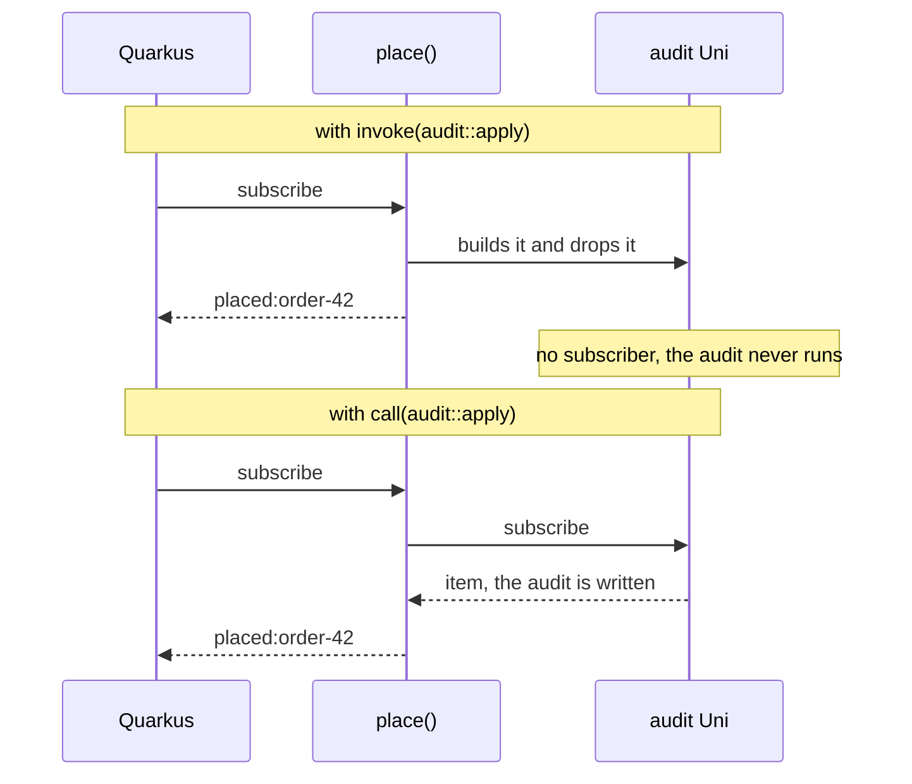
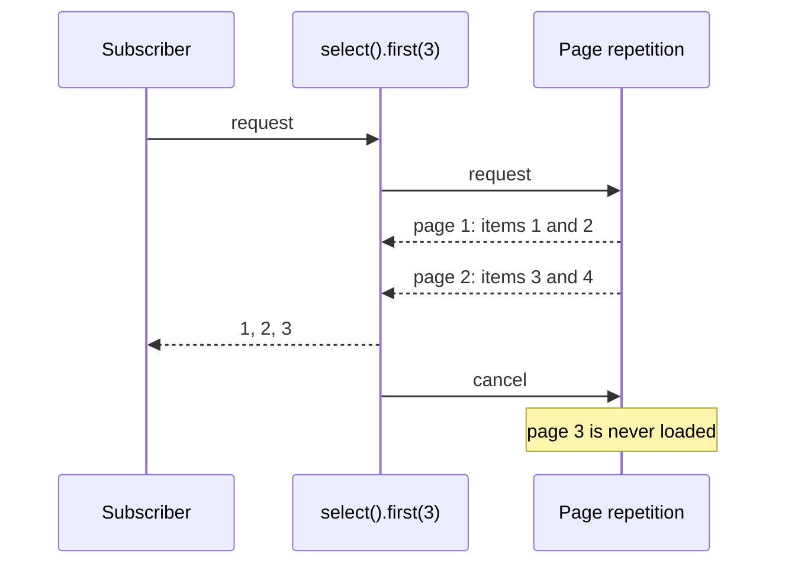

This method places an order after writing it to an audit log. The audit is asynchronous, so it returns a `Uni<Void>`:

```java
public Uni<String> place(String order) {
    return Uni.createFrom().item(order)
            .invoke(audit::apply)
            .map(placed -> "placed:" + placed);
}
```

It compiles. It runs. It returns `placed:order-42`. And the audit log stays empty:

```text
expected: <[order-42]> but was: <[]>
```

Nothing failed, nothing was logged, and the bug would reach production unnoticed. To see why, you need one idea that the rest of Mutiny follows from: **a `Uni` is a recipe, not a result**.

[Part 1](/en/posts/quarkus-event-loop-from-the-ground-up/) of this series went below Quarkus, to the event loop. [Part 2](/en/posts/quarkus-who-runs-your-code/) showed how Quarkus picks the thread where your method starts. This part is about what happens after it starts, when the method returns a `Uni` or a `Multi`.

## The lab

The tests in this article live in `labs/mutiny` of the [demo](https://github.com/omatheusmesmo/demos/tree/main/quarkus/reactive-core): plain JUnit, Mutiny 3.3.0, no Quarkus, so they run in seconds. Each behaviour is driven by a small production class, and each test was first run against a naive version of that class. The red messages are kept in the module's README, because they explain the behaviour better than prose. Two tests come from the REST Client module, where timeouts need a real slow server. Quarkus 3.40.1 and 4.0.0.Beta1 both ship Mutiny 3.3.0, and every test here passes on both.

## 1. Nothing happens until someone subscribes

The Mutiny documentation says it plainly:

> If no subscriber _subscribes_, no items will be emitted. More importantly, nothing will ever happen.

`ExchangeRates` wraps a remote call in a `Uni`. The tests count how many times the remote service is called:

```java
public Uni<String> rate() {
    return Uni.createFrom().item(fetchRate);
}
```

```java
@Test
void buildingAUniCallsNothing() {
    Uni<String> rate = rates.rate();

    assertEquals(0, remoteCalls.get());
}

@Test
void eachSubscriptionCallsTheRemoteServiceAgain() {
    Uni<String> rate = rates.rate();

    assertEquals("5.41", rate.await().atMost(TIMEOUT));
    assertEquals("5.42", rate.await().atMost(TIMEOUT));
    assertEquals(2, remoteCalls.get());
}
```

Building the `Uni` calls nothing. Subscribing calls the service, and subscribing again calls it again. That is the difference from a `CompletableFuture`, which represents work that has already started. A `Uni` describes work that has not.

Two details turn this into bugs. The first is the argument you pass:

```java
public Uni<String> rateFetchedRightAway() {
    return Uni.createFrom().item(fetchRate.get());
}
```

With a value instead of a supplier, the call runs **while the `Uni` is built**, before anyone subscribes, and the test sees one remote call with no subscription at all. `item(supplier)` and `item(value)` look almost the same and behave in opposite ways.

The second is when you want a result instead of a recipe. `memoize()` does that: the first subscription runs the call, and every later one gets the same item.

```java
this.shared = rate().memoize().indefinitely();
```

Two subscriptions, one remote call. Use it on purpose: from then on, every subscriber gets that first result, however old it is.

## 2. Who subscribes in Quarkus

If nothing happens without a subscription, who subscribes in a Quarkus application? Clement Escoffier answered it in a post about retries:

> In Quarkus, most of the time, you return the Uni, and Quarkus subscribes to it. So, don't be mistaken, there is a subscription, you may not see it.

Quarkus REST subscribes to the `Uni` your endpoint returns. Reactive Messaging subscribes to the `Uni` your consumer returns. **A `Uni` that you build and do not return, or do not chain into the one you return, is never subscribed.** That is the opening bug.

`invoke` is for synchronous side effects. Its callback returns nothing, so when you pass `audit::apply`, a method that returns a `Uni<Void>`, Java accepts it as a `Consumer` and throws the returned `Uni` away. Nobody subscribes to it, so the audit never runs. The operator for an asynchronous side effect is `call`:

```java
public Uni<String> place(String order) {
    return Uni.createFrom().item(order)
            .call(audit::apply)
            .map(placed -> "placed:" + placed);
}
```

Escoffier's post on the two operators describes the difference precisely. For `invoke`, "Mutiny invokes the callback and propagates the event downstream when the callback returns. It blocks the dispatching." For `call`, "Mutiny does not dispatch the original event downstream until the Uni returned by the callback emits an item".

| | `invoke` | `call` |
|---|---|---|
| Callback returns | nothing | a `Uni` |
| Subscribes to what the callback returns | no | yes, and waits for its item |
| Use it for | logging, a quick synchronous side effect | an asynchronous side effect: audit, flush, close |



The same mistake shows up with Hibernate Reactive: `repository.persist(entity)` returns a `Uni`, and calling it on its own line, without chaining it into the `Uni` you return, leaves that `Uni` with no subscriber. The rule is always the same: every `Uni` has to end up in the chain that somebody subscribes to.

## 3. Retry is resubscription

Laziness is not only a trap. It is what makes retry possible. You cannot rerun a `CompletableFuture` that has already finished, but you can follow a recipe again. Escoffier again:

> It resubscribes until it gets a successful response. In other words, retrying is resubscribing.

`RetryingCall` wraps `onFailure().retry().atMost(2)`, and the test counts subscriptions to a flaky source that fails twice:

```java
String result = retrying.call(flaky).await().atMost(Duration.ofSeconds(5));

assertEquals("ok", result);
assertEquals(3, subscriptions.get());
```

Three subscriptions: the first attempt and two retries. When every attempt fails, the caller gets the **last** failure, `failure-3`. And since each retry runs the whole upstream again, the same post has the warning that matters more than the API: "you can only retry if your system is idempotent". `withBackOff`, `withJitter` and `expireIn` control when to retry; none of them makes a non-idempotent call safe to repeat.

## 4. Mutiny schedules nothing

Part 2 was about which thread starts your method. Inside a pipeline, the Mutiny documentation sets the rule:

> Except indicated otherwise, Mutiny invokes the next _stage_ using the thread emitting the event from upstream.

and, on the page about pitfalls, the stronger version:

> Mutiny itself **does not perform any scheduling work**, except for the `emitOn` and `runSubscriptionOn` operators.

`BlockingLookup` wraps a blocking call in a `Uni`. Without any operator, the call runs on the thread that subscribes, which in the test is the test's own thread. In Quarkus, that would be the event loop if the endpoint returns the `Uni`. Wrapping blocking code in a `Uni` does not make it non-blocking; it only delays it until the subscription.

The two operators that move work do it in opposite directions:

| Operator | Moves | Typical use |
|---|---|---|
| `runSubscriptionOn(executor)` | the subscription, so the work done when subscribing, such as a blocking call | a blocking source |
| `emitOn(executor)` | every event that follows: items, failure, completion | processing each item somewhere else |

The tests confirm both: with `runSubscriptionOn`, the blocking call runs on `lookup-worker`; with `emitOn`, every stage after it runs on `processor-worker`. The documentation adds a warning worth repeating: `emitOn` "can lead to concurrency problems with non thread-safe objects such as CDI request-scoped beans". In Quarkus, the default executor of Mutiny is the worker pool, and as part 1 showed, `await()` refuses to run on an event loop.


## 5. `combine` does not run anything in parallel

`QuoteAggregator` joins two quotes with `Uni.combine().all().unis(first, second)`. It looks like a parallel call. The pitfalls page says otherwise:

> You might think that the `join` operator schedules the calls to `fetch` to be run concurrently, and then collects the results into a list. This is not how it works!

The test records a timeline with two synchronous sources:

```java
assertEquals(List.of("a:start", "a:end", "b:start", "b:end"), timeline);
```

`combine` subscribes to the first source, which runs to the end on the subscribing thread, and only then subscribes to the second. The sources only overlap when they are **asynchronous**, which is what the second test shows: each source runs on its own thread and waits until the other has started. A naive version that chained the two sources with `chain` failed that test with `expected: <[a, b]> but was: <[a:ran-alone, b]>`: the first source waited a second for the second, which only started after it.

In a real Quarkus application, the overlap comes from the source, not from `combine`. In the REST Client module, the reactive endpoint combines two calls to a slow upstream. The calls overlap because the reactive REST Client does not hold a thread while it waits for a response: subscribing to the first `Uni` sends the request and returns, and the second request goes out right after.

```java
return Uni.combine().all()
        .unis(upstream.quoteAsync(), upstream.quoteAsync())
        .with((first, second) -> List.of(first, second))
        .ifNoItem().after(TIMEOUT).fail()
        .map(Observed::of);
```

The same pitfalls page has a related warning: a `Uni` or `Multi` whose initial source does no I/O and already has its data in memory "is suspicious". It is fine in a test and a warning sign in production.

On a `Multi`, the same question is about order. `transformToUniAndConcatenate` waits for each call and keeps the input order; `transformToUniAndMerge` runs them concurrently and emits in completion order. With calls that take longer for smaller numbers, the first returns `[1, 2, 3]` and the second `[3, 2, 1]`.

## 6. A failure ends the stream

In Mutiny, a failure is an event, like an item. It is also a **terminal** event. Escoffier's post on failure handling says "Failures are terminal events. If your upstream propagates a failure, it means it can't operate normally", and the consequence surprises people on a `Multi`:

```java
List<Integer> items = stream.recoverAtTheEnd(Multi.createFrom().range(0, 10), REJECT_SEVEN, FALLBACK)
        .collect().asList().await().atMost(Duration.ofSeconds(5));

assertEquals(List.of(0, 1, 2, 3, 4, 5, 6, FALLBACK), items);
```

The mapper rejects 7, `recoverWithItem` emits the fallback, and the stream ends. Items 8 and 9 never arrive, because the stage that failed cancelled its upstream. Recovering does not bring the stream back.

The fix is to give each item its own `Uni`, so the failure and the recovery stay inside it:

```java
return items.onItem().transformToUniAndConcatenate(item -> Uni.createFrom().item(() -> mapper.apply(item))
        .onFailure().recoverWithItem(fallback));
```

Now the result is `[0, 1, 2, 3, 4, 5, 6, FALLBACK, 8, 9]`. This is also why a Kafka consumer built on a single `Multi` can stop consuming after one bad message.

## 7. Demand flows upstream

Items flow down a `Multi`; requests and cancellations flow up. The Mutiny documentation calls the request "the cornerstone of the back-pressure protocol", and three tests show what it buys.

**A source that respects demand produces only what was asked for.** `Sensors` is an endless stream built with `Multi.createFrom().generator(...)`. The test requests three readings and cancels:

```java
AssertMulti.create(sensors.readings())
        .withInitialRequest(0)
        .thenRequest(3)
        .expectNext(1, 2, 3)
        .thenCancel()
        .verify();

assertEquals(3, produced.get());
```

The naive version used an emitter that ignored demand and failed with `expected: <3> but was: <100>`.

**Cancellation travels to the source.** `PageFetcher` turns a paginated API into a stream of items, the way Escoffier's pagination post does: it repeats a page call until a page comes back empty.

```java
return Multi.createBy().repeating()
        .uni(AtomicInteger::new, page -> loadPage.apply(page.incrementAndGet()))
        .until(List::isEmpty)
        .onItem().disjoint();
```

With pages of two items and a consumer that takes the first three with `select().first(3)`, the test asserts that exactly **two** pages were loaded. When `first(3)` has enough, it cancels, the cancellation reaches the repetition, and no other page is requested. The imperative loop would need a counter and a `break` to do the same.



**A source that cannot slow down needs a decision.** Ticks, user input and sensors on a push protocol do not wait for requests. For them, Mutiny has `onOverflow()`. `BurstBuffer` uses a bounded buffer, and the test shows what happens when it fills up: the subscriber gets a `BackPressureFailure` instead of a heap that keeps growing. Escoffier's view of the alternative, an unbounded buffer: "In general, that's a terrible idea as you may run out of memory."

Not every source should be a `Multi`. The pitfalls page makes the point that databases do not stream: a SQL query returns all its rows, and the protocol has no back-pressure, so `Uni<List<Row>>` describes it more honestly than `Multi<Row>`.

## 8. Time is an event too, and there are two `TimeoutException`s

A recipe can also wait forever, so every model in the demo bounds its wait. The REST Client module has an upstream that takes two seconds and a one-second budget, and `TimeoutTest` expects a `504` from each variant:

| Variant | Mechanism |
|---|---|
| worker | the REST Client read timeout |
| reactive | `ifNoItem().after(TIMEOUT).fail()` |
| virtual thread | `await().atMost(TIMEOUT)` |

`ifNoItem()` treats the absence of an item as an event you can react to: fail, recover with a fallback or switch to another `Uni`.

Writing this test turned up a trap. In the reactive variant, two timeouts race: Mutiny's `ifNoItem` and the REST Client read timeout. Which one wins depends on configuration, so `ClientTimeoutFirstTest` shortens the read timeout to make the client win every time. The failure that reaches the endpoint is then not Mutiny's:

| Class | Extends | Raised by |
|---|---|---|
| `io.smallrye.mutiny.TimeoutException` | `RuntimeException` | `ifNoItem().fail()`, `await().atMost()` |
| `io.vertx.core.impl.NoStackTraceTimeoutException` | `java.util.concurrent.TimeoutException`, a **checked** exception | the reactive REST Client |

An exception mapper declared for `RuntimeException` never sees the second one. The demo's mappers take `Exception` and search the cause chain for any timeout, which is how the test gets its `504`. The hierarchy is the same in Vert.x 4.5.34 and 5.1.8. If your mapper or fault tolerance policy catches `RuntimeException` to handle timeouts from the reactive client, test it with a timeout the client raises itself.

## 9. What changed since 2020

Most of what is written about Mutiny online comes from 2020, including Escoffier's excellent series on the Quarkus blog. The ideas hold; some of the API does not. I checked every call against the Mutiny 3.3.0 sources:

| 2020 | Mutiny 3.3.0 |
|---|---|
| `collectItems().asList()` | `collect().asList()` |
| `transform().byFilteringItemsWith(p)` | `select().where(p)` |
| `transform().byTakingFirstItems(n)` | `select().first(n)` |
| `onSubscribe().invoke(...)` | `onSubscription().invoke(...)` |
| `onOverflow().drop(x -> log(x))` | `onOverflow().invoke(x -> log(x)).drop()` |
| `org.reactivestreams.Subscriber` | `java.util.concurrent.Flow.Subscriber` |

Almost all of it changed in **Mutiny 2**, which moved to `java.util.concurrent.Flow`. Mutiny 3.0 had only two changes marked as breaking: `Uni.join().all()` accepts an empty list, and `onFailure(RuntimeException.class)` became typed. Failure handling, retries, `combine`, `transformToUniAndMerge` and the pagination pattern are unchanged.

## Conclusion

A `Uni` is a description of work. Building it does nothing; subscribing runs it, and every subscription runs it again. That one idea explains the audit that never ran (nobody subscribed to the `Uni` that `invoke` dropped), retry (a new subscription), the call that ran too early (`item(value)` instead of a supplier) and `memoize` (turning the recipe into a result).

Mutiny does not decide threads either. A stage runs on the thread that emitted the event, `combine` and `merge` only overlap work that is already asynchronous, and only `emitOn` and `runSubscriptionOn` move anything. When the work does flow, demand flows back: sources produce what was requested, cancellation stops them, and failures end a stream unless you contain them per item.

With that, the series has covered the three ways Quarkus runs your code: on an event loop, on a worker and on a virtual thread. Part 4 puts them side by side under load, with the Quarkus 4 stack underneath: which one to pick, and what limits each of them, which is rarely the model itself.

## Resources

- [Demo: `quarkus/reactive-core`](https://github.com/omatheusmesmo/demos/tree/main/quarkus/reactive-core): `labs/mutiny` (every package) and `integrations/rest-client` (`TimeoutTest`, `ClientTimeoutFirstTest`)
- Mutiny documentation: [What makes Mutiny different](https://smallrye.io/smallrye-mutiny/latest/reference/what-makes-mutiny-different/), [emitOn vs runSubscriptionOn](https://smallrye.io/smallrye-mutiny/latest/guides/emit-on-vs-run-subscription-on/), [Going reactive: a few pitfalls](https://smallrye.io/smallrye-mutiny/latest/reference/going-reactive-a-few-pitfalls/), [Controlling the demand](https://smallrye.io/smallrye-mutiny/latest/guides/controlling-demand/)
- Clement Escoffier on the Quarkus blog (2020): [failure handling](https://quarkus.io/blog/mutiny-failure-handling/), [pagination](https://quarkus.io/blog/mutiny-pagination/), [concurrent calls](https://quarkus.io/blog/mutiny-concurrent-uni/), [retry](https://quarkus.io/blog/uni-retry/), [back-pressure](https://quarkus.io/blog/mutiny-back-pressure/), [invoke and call](https://quarkus.io/blog/mutiny-invoke-and-call/)
- [Mutiny primer in Quarkus](https://quarkus.io/guides/mutiny-primer)
- Previously in this series: [part 1, the event loop from the ground up](/en/posts/quarkus-event-loop-from-the-ground-up/) and [part 2, who runs your code](/en/posts/quarkus-who-runs-your-code/)
