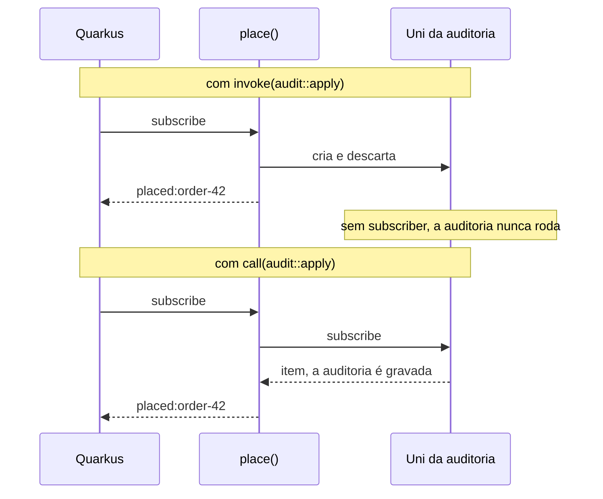
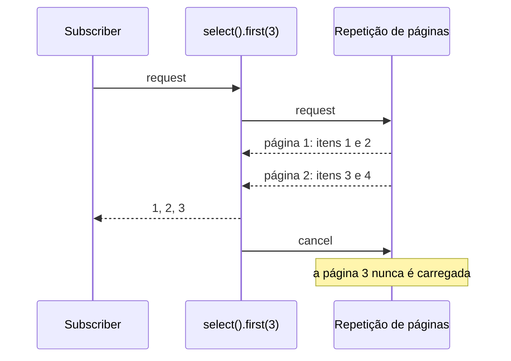

Este método registra um pedido depois de gravá-lo num log de auditoria. A auditoria é assíncrona, então devolve um `Uni<Void>`:

```java
public Uni<String> place(String order) {
    return Uni.createFrom().item(order)
            .invoke(audit::apply)
            .map(placed -> "placed:" + placed);
}
```

Compila. Roda. Devolve `placed:order-42`. E o log de auditoria fica vazio:

```text
expected: <[order-42]> but was: <[]>
```

Nada falhou, nada foi logado, e o bug chegaria em produção sem ninguém perceber. Para entender por quê, você precisa de uma ideia da qual o resto do Mutiny decorre: **um `Uni` é uma receita, não um resultado**.

A [parte 1](/posts/quarkus-event-loop-do-zero/) desta série desceu abaixo do Quarkus, até o event loop. A [parte 2](/posts/quarkus-quem-roda-o-seu-codigo/) mostrou como o Quarkus escolhe a thread em que o seu método começa. Esta parte é sobre o que acontece depois que ele começa, quando o método devolve um `Uni` ou um `Multi`.

## O laboratório

Os testes deste artigo moram em `labs/mutiny` do [demo](https://github.com/omatheusmesmo/demos/tree/main/quarkus/reactive-core): JUnit puro, Mutiny 3.3.0, sem Quarkus, então rodam em segundos. Cada comportamento é guiado por uma pequena classe de produção, e cada teste rodou primeiro contra uma versão ingênua dessa classe. As mensagens vermelhas ficaram no README do módulo, porque explicam o comportamento melhor que um texto. Dois testes vêm do módulo de REST Client, onde timeouts precisam de um servidor lento de verdade. O Quarkus 3.40.1 e a 4.0.0.Beta1 trazem o Mutiny 3.3.0, e todos os testes daqui passam nos dois.

## 1. Nada acontece até alguém fazer a subscription

A documentação do Mutiny diz sem rodeios:

> If no subscriber _subscribes_, no items will be emitted. More importantly, nothing will ever happen.

O `ExchangeRates` embrulha uma chamada remota num `Uni`. Os testes contam quantas vezes o serviço remoto é chamado:

```java
public Uni<String> rate() {
    return Uni.createFrom().item(fetchRate);
}
```

```java
@Test
void buildingAUniCallsNothing() {
    Uni<String> rate = rates.rate();

    assertEquals(0, remoteCalls.get());
}

@Test
void eachSubscriptionCallsTheRemoteServiceAgain() {
    Uni<String> rate = rates.rate();

    assertEquals("5.41", rate.await().atMost(TIMEOUT));
    assertEquals("5.42", rate.await().atMost(TIMEOUT));
    assertEquals(2, remoteCalls.get());
}
```

Construir o `Uni` não chama nada. A subscription chama o serviço, e uma nova subscription chama de novo. Essa é a diferença para um `CompletableFuture`, que representa um trabalho que já começou. Um `Uni` descreve um trabalho que ainda não começou.

Dois detalhes transformam isso em bug. O primeiro é o argumento que você passa:

```java
public Uni<String> rateFetchedRightAway() {
    return Uni.createFrom().item(fetchRate.get());
}
```

Com um valor no lugar de um supplier, a chamada roda **enquanto o `Uni` é construído**, antes de qualquer subscription, e o teste vê uma chamada remota sem nenhuma subscription. `item(supplier)` e `item(valor)` parecem quase iguais e se comportam de jeitos opostos.

O segundo é quando você quer um resultado, e não uma receita. O `memoize()` faz isso: a primeira subscription roda a chamada, e todas as seguintes recebem o mesmo item.

```java
this.shared = rate().memoize().indefinitely();
```

Duas subscriptions, uma chamada remota. Use de propósito: a partir daí, todo subscriber recebe aquele primeiro resultado, por mais velho que ele seja.

## 2. Quem faz a subscription no Quarkus

Se nada acontece sem subscription, quem faz a subscription numa aplicação Quarkus? Clement Escoffier respondeu num post sobre retries:

> In Quarkus, most of the time, you return the Uni, and Quarkus subscribes to it. So, don't be mistaken, there is a subscription, you may not see it.

O Quarkus REST faz a subscription do `Uni` que o seu endpoint devolve. O Reactive Messaging faz a do `Uni` que o seu consumer devolve. **Um `Uni` que você constrói e não devolve, nem encadeia no que você devolve, nunca recebe uma subscription.** É o bug do começo.

O `invoke` é para efeitos colaterais síncronos. O callback dele não devolve nada, então quando você passa `audit::apply`, um método que devolve um `Uni<Void>`, o Java o aceita como `Consumer` e joga fora o `Uni` devolvido. Ninguém faz a subscription dele, então a auditoria nunca roda. O operador para um efeito colateral assíncrono é o `call`:

```java
public Uni<String> place(String order) {
    return Uni.createFrom().item(order)
            .call(audit::apply)
            .map(placed -> "placed:" + placed);
}
```

O post do Escoffier sobre os dois operadores descreve a diferença com precisão. Para o `invoke`, "Mutiny invokes the callback and propagates the event downstream when the callback returns. It blocks the dispatching." Para o `call`, "Mutiny does not dispatch the original event downstream until the Uni returned by the callback emits an item".

| | `invoke` | `call` |
|---|---|---|
| O callback devolve | nada | um `Uni` |
| Faz a subscription do que o callback devolve | não | sim, e espera o item |
| Use para | log, um efeito colateral síncrono e rápido | um efeito colateral assíncrono: auditoria, flush, fechar recurso |



O mesmo erro aparece com o Hibernate Reactive: `repository.persist(entity)` devolve um `Uni`, e chamá-lo numa linha sozinha, sem encadear no `Uni` que você devolve, deixa esse `Uni` sem subscriber. A regra é sempre a mesma: todo `Uni` precisa acabar na cadeia que alguém vai assinar.

## 3. Retry é uma nova subscription

Laziness não é só armadilha. É o que torna o retry possível. Não dá para rodar de novo um `CompletableFuture` que já terminou, mas dá para seguir uma receita de novo. O Escoffier de novo:

> It resubscribes until it gets a successful response. In other words, retrying is resubscribing.

O `RetryingCall` embrulha `onFailure().retry().atMost(2)`, e o teste conta as subscriptions de uma fonte instável que falha duas vezes:

```java
String result = retrying.call(flaky).await().atMost(Duration.ofSeconds(5));

assertEquals("ok", result);
assertEquals(3, subscriptions.get());
```

Três subscriptions: a primeira tentativa e dois retries. Quando todas as tentativas falham, quem chamou recebe a **última** falha, `failure-3`. E como cada retry roda o upstream inteiro de novo, o mesmo post traz o aviso que importa mais que a API: "you can only retry if your system is idempotent". `withBackOff`, `withJitter` e `expireIn` controlam quando tentar de novo; nenhum deles torna seguro repetir uma chamada que não é idempotente.

## 4. O Mutiny não agenda nada

A parte 2 foi sobre qual thread começa o seu método. Dentro de um pipeline, a documentação do Mutiny define a regra:

> Except indicated otherwise, Mutiny invokes the next _stage_ using the thread emitting the event from upstream.

e, na página de armadilhas, a versão mais forte:

> Mutiny itself **does not perform any scheduling work**, except for the `emitOn` and `runSubscriptionOn` operators.

O `BlockingLookup` embrulha uma chamada bloqueante num `Uni`. Sem nenhum operador, a chamada roda na thread que faz a subscription, que no teste é a própria thread do teste. No Quarkus, seria o event loop se o endpoint devolvesse o `Uni`. Embrulhar código bloqueante num `Uni` não o torna não bloqueante; só o adia até a subscription.

Os dois operadores que movem trabalho fazem isso em direções opostas:

| Operador | Move | Uso típico |
|---|---|---|
| `runSubscriptionOn(executor)` | a subscription, ou seja, o trabalho feito ao assinar, como uma chamada bloqueante | uma fonte bloqueante |
| `emitOn(executor)` | todo evento que vem depois: itens, falha, completion | processar cada item em outro lugar |

Os testes confirmam os dois: com `runSubscriptionOn`, a chamada bloqueante roda em `lookup-worker`; com `emitOn`, todo estágio depois dele roda em `processor-worker`. A documentação acrescenta um aviso que vale repetir: o `emitOn` "can lead to concurrency problems with non thread-safe objects such as CDI request-scoped beans". No Quarkus, o executor padrão do Mutiny é o worker pool, e, como a parte 1 mostrou, o `await()` se recusa a rodar num event loop.


## 5. O `combine` não roda nada em paralelo

O `QuoteAggregator` junta duas cotações com `Uni.combine().all().unis(first, second)`. Parece uma chamada paralela. A página de armadilhas diz que não:

> You might think that the `join` operator schedules the calls to `fetch` to be run concurrently, and then collects the results into a list. This is not how it works!

O teste registra uma linha do tempo com duas fontes síncronas:

```java
assertEquals(List.of("a:start", "a:end", "b:start", "b:end"), timeline);
```

O `combine` faz a subscription da primeira fonte, que roda até o fim na thread que assinou, e só então faz a da segunda. As fontes só se sobrepõem quando são **assíncronas**, que é o que o segundo teste mostra: cada fonte roda na sua própria thread e espera até a outra ter começado. Uma versão ingênua que encadeava as duas fontes com `chain` falhou nesse teste com `expected: <[a, b]> but was: <[a:ran-alone, b]>`: a primeira fonte esperou um segundo pela segunda, que só começou depois dela.

Numa aplicação Quarkus de verdade, a sobreposição vem da fonte, não do `combine`. No módulo de REST Client, o endpoint reativo combina duas chamadas a um upstream lento. As chamadas se sobrepõem porque o REST Client reativo não segura uma thread enquanto espera a resposta: a subscription do primeiro `Uni` envia a requisição e retorna, e a segunda requisição sai logo depois.

```java
return Uni.combine().all()
        .unis(upstream.quoteAsync(), upstream.quoteAsync())
        .with((first, second) -> List.of(first, second))
        .ifNoItem().after(TIMEOUT).fail()
        .map(Observed::of);
```

A mesma página de armadilhas tem um aviso parecido: um `Uni` ou `Multi` cuja fonte inicial não faz I/O e já tem os dados em memória "is suspicious". Tudo bem num teste, sinal de alerta em produção.

Num `Multi`, a mesma pergunta é sobre ordem. O `transformToUniAndConcatenate` espera cada chamada e mantém a ordem de entrada; o `transformToUniAndMerge` roda as chamadas ao mesmo tempo e emite na ordem em que terminam. Com chamadas que demoram mais para números menores, o primeiro devolve `[1, 2, 3]` e o segundo `[3, 2, 1]`.

## 6. Uma falha encerra o stream

No Mutiny, uma falha é um evento, como um item. Também é um evento **terminal**. O post do Escoffier sobre tratamento de falhas diz "Failures are terminal events. If your upstream propagates a failure, it means it can't operate normally", e a consequência surpreende num `Multi`:

```java
List<Integer> items = stream.recoverAtTheEnd(Multi.createFrom().range(0, 10), REJECT_SEVEN, FALLBACK)
        .collect().asList().await().atMost(Duration.ofSeconds(5));

assertEquals(List.of(0, 1, 2, 3, 4, 5, 6, FALLBACK), items);
```

O mapper rejeita o 7, o `recoverWithItem` emite o fallback e o stream acaba. Os itens 8 e 9 nunca chegam, porque o estágio que falhou cancelou o upstream. Recuperar não traz o stream de volta.

A correção é dar a cada item o seu próprio `Uni`, para que a falha e a recuperação fiquem dentro dele:

```java
return items.onItem().transformToUniAndConcatenate(item -> Uni.createFrom().item(() -> mapper.apply(item))
        .onFailure().recoverWithItem(fallback));
```

Agora o resultado é `[0, 1, 2, 3, 4, 5, 6, FALLBACK, 8, 9]`. É também por isso que um consumer de Kafka montado sobre um único `Multi` pode parar de consumir depois de uma mensagem ruim.

## 7. A demanda sobe

Itens descem por um `Multi`; requests e cancelamentos sobem. A documentação do Mutiny chama o request de "the cornerstone of the back-pressure protocol", e três testes mostram o que isso compra.

**Uma fonte que respeita a demanda produz só o que foi pedido.** O `Sensors` é um stream infinito montado com `Multi.createFrom().generator(...)`. O teste pede três leituras e cancela:

```java
AssertMulti.create(sensors.readings())
        .withInitialRequest(0)
        .thenRequest(3)
        .expectNext(1, 2, 3)
        .thenCancel()
        .verify();

assertEquals(3, produced.get());
```

A versão ingênua usava um emitter que ignorava a demanda e falhou com `expected: <3> but was: <100>`.

**O cancelamento viaja até a fonte.** O `PageFetcher` transforma uma API paginada num stream de itens, do jeito que o post do Escoffier sobre paginação faz: repete a chamada de página até uma página vir vazia.

```java
return Multi.createBy().repeating()
        .uni(AtomicInteger::new, page -> loadPage.apply(page.incrementAndGet()))
        .until(List::isEmpty)
        .onItem().disjoint();
```

Com páginas de dois itens e um consumer que pega os três primeiros com `select().first(3)`, o teste verifica que exatamente **duas** páginas foram carregadas. Quando o `first(3)` tem o suficiente, ele cancela, o cancelamento chega na repetição, e nenhuma outra página é pedida. O loop imperativo precisaria de um contador e de um `break` para fazer o mesmo.



**Uma fonte que não pode desacelerar exige uma decisão.** Ticks, entrada do usuário e sensores num protocolo push não esperam requests. Para eles, o Mutiny tem o `onOverflow()`. O `BurstBuffer` usa um buffer limitado, e o teste mostra o que acontece quando ele enche: o subscriber recebe uma `BackPressureFailure` em vez de um heap que não para de crescer. A opinião do Escoffier sobre a alternativa, um buffer ilimitado: "In general, that's a terrible idea as you may run out of memory."

Nem toda fonte deveria ser um `Multi`. A página de armadilhas lembra que bancos de dados não fazem streaming: uma query SQL devolve todas as linhas, e o protocolo não tem back-pressure, então `Uni<List<Row>>` descreve isso com mais honestidade que `Multi<Row>`.

## 8. O tempo também é um evento, e existem duas `TimeoutException`

Uma receita também pode esperar para sempre, então todo modelo do demo limita a espera. O módulo de REST Client tem um upstream que demora dois segundos e um orçamento de um segundo, e o `TimeoutTest` espera um `504` de cada variante:

| Variante | Mecanismo |
|---|---|
| worker | o read timeout do REST Client |
| reativa | `ifNoItem().after(TIMEOUT).fail()` |
| virtual thread | `await().atMost(TIMEOUT)` |

O `ifNoItem()` trata a ausência de um item como um evento ao qual você pode reagir: falhar, recuperar com um fallback ou trocar por outro `Uni`.

Escrever esse teste revelou uma armadilha. Na variante reativa, dois timeouts disputam: o `ifNoItem` do Mutiny e o read timeout do REST Client. Qual ganha depende da configuração, então o `ClientTimeoutFirstTest` encurta o read timeout para o cliente ganhar sempre. A falha que chega no endpoint, nesse caso, não é a do Mutiny:

| Classe | Estende | Lançada por |
|---|---|---|
| `io.smallrye.mutiny.TimeoutException` | `RuntimeException` | `ifNoItem().fail()`, `await().atMost()` |
| `io.vertx.core.impl.NoStackTraceTimeoutException` | `java.util.concurrent.TimeoutException`, uma exceção **checked** | o REST Client reativo |

Um exception mapper declarado para `RuntimeException` nunca vê a segunda. Os mappers do demo recebem `Exception` e procuram qualquer timeout na cadeia de causas, e é assim que o teste ganha o seu `504`. A hierarquia é a mesma no Vert.x 4.5.34 e no 5.1.8. Se o seu mapper ou a sua política de fault tolerance pega `RuntimeException` para tratar timeouts do cliente reativo, teste com um timeout lançado pelo próprio cliente.

## 9. O que mudou desde 2020

Boa parte do que existe escrito sobre Mutiny na internet é de 2020, incluindo a ótima série do Escoffier no blog do Quarkus. As ideias continuam valendo; parte da API, não. Conferi cada chamada contra o código do Mutiny 3.3.0:

| 2020 | Mutiny 3.3.0 |
|---|---|
| `collectItems().asList()` | `collect().asList()` |
| `transform().byFilteringItemsWith(p)` | `select().where(p)` |
| `transform().byTakingFirstItems(n)` | `select().first(n)` |
| `onSubscribe().invoke(...)` | `onSubscription().invoke(...)` |
| `onOverflow().drop(x -> log(x))` | `onOverflow().invoke(x -> log(x)).drop()` |
| `org.reactivestreams.Subscriber` | `java.util.concurrent.Flow.Subscriber` |

Quase tudo isso mudou no **Mutiny 2**, que passou a usar `java.util.concurrent.Flow`. O Mutiny 3.0 teve só duas mudanças marcadas como quebra: o `Uni.join().all()` aceita lista vazia, e o `onFailure(RuntimeException.class)` passou a ser tipado. Tratamento de falhas, retries, `combine`, `transformToUniAndMerge` e o padrão de paginação continuam iguais.

## Conclusão

Um `Uni` é a descrição de um trabalho. Construí-lo não faz nada; a subscription o executa, e cada subscription o executa de novo. Essa única ideia explica a auditoria que nunca rodou (ninguém fez a subscription do `Uni` que o `invoke` descartou), o retry (uma nova subscription), a chamada que rodou cedo demais (`item(valor)` no lugar de um supplier) e o `memoize` (transformar a receita num resultado).

O Mutiny também não decide threads. Um estágio roda na thread que emitiu o evento, `combine` e `merge` só sobrepõem trabalho que já é assíncrono, e só o `emitOn` e o `runSubscriptionOn` movem alguma coisa. Quando o trabalho flui, a demanda volta: fontes produzem o que foi pedido, o cancelamento as para, e falhas encerram um stream a não ser que você as contenha item a item.

Com isso, a série cobriu os três jeitos como o Quarkus roda o seu código: num event loop, numa worker e numa virtual thread. A parte 4 os coloca lado a lado sob carga, com a pilha do Quarkus 4 por baixo: qual escolher, e o que limita cada um, que raramente é o próprio modelo.

## Recursos

- [Demo: `quarkus/reactive-core`](https://github.com/omatheusmesmo/demos/tree/main/quarkus/reactive-core): `labs/mutiny` (todos os pacotes) e `integrations/rest-client` (`TimeoutTest`, `ClientTimeoutFirstTest`)
- Documentação do Mutiny: [What makes Mutiny different](https://smallrye.io/smallrye-mutiny/latest/reference/what-makes-mutiny-different/), [emitOn vs runSubscriptionOn](https://smallrye.io/smallrye-mutiny/latest/guides/emit-on-vs-run-subscription-on/), [Going reactive: a few pitfalls](https://smallrye.io/smallrye-mutiny/latest/reference/going-reactive-a-few-pitfalls/), [Controlling the demand](https://smallrye.io/smallrye-mutiny/latest/guides/controlling-demand/)
- Clement Escoffier no blog do Quarkus (2020): [tratamento de falhas](https://quarkus.io/blog/mutiny-failure-handling/), [paginação](https://quarkus.io/blog/mutiny-pagination/), [chamadas concorrentes](https://quarkus.io/blog/mutiny-concurrent-uni/), [retry](https://quarkus.io/blog/uni-retry/), [back-pressure](https://quarkus.io/blog/mutiny-back-pressure/), [invoke e call](https://quarkus.io/blog/mutiny-invoke-and-call/)
- [Mutiny primer no Quarkus](https://quarkus.io/guides/mutiny-primer)
- Antes nesta série: [parte 1, o event loop do zero](/posts/quarkus-event-loop-do-zero/) e [parte 2, quem roda o seu código](/posts/quarkus-quem-roda-o-seu-codigo/)
