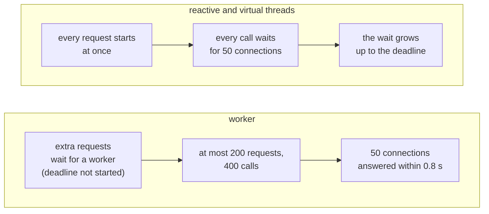
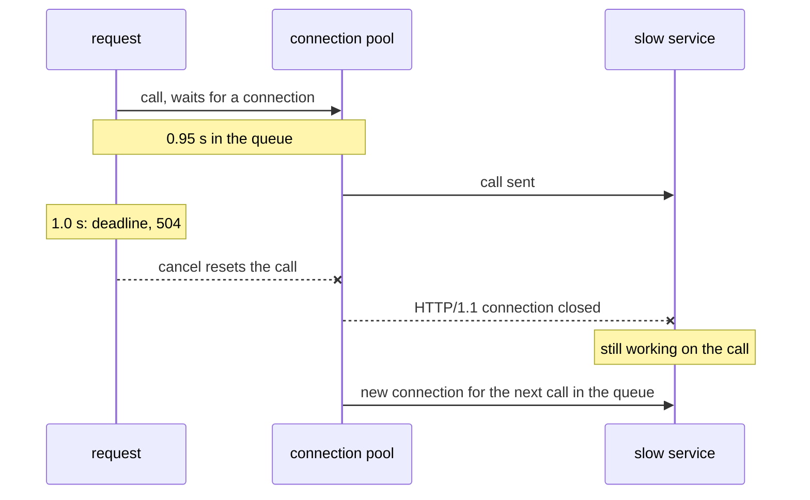

Benchmark the three models the quick way and you get a clean table. The quick way means a load generator in its usual closed mode, where each virtual user waits for an answer before it sends the next request, and each model written in its most natural shape. This table comes from an early run of the demo, in the scenario that calls a slow HTTP service twice per request, with the connection pool widened so it does not get in the way:

| Model | Requests/s | Median latency (p50) |
|---|---|---|
| worker threads | 988 | 403 ms |
| virtual threads | 1,964 | 202 ms |
| reactive | 3,928 | 101 ms |

Virtual threads twice as fast as workers, reactive four times. A table like that ends up in slides, and it measures two things that are not the models.

The first is the load generator. Here it ran 400 virtual users in a loop. With 400 users and a latency of 200 ms, the most it can measure is 400 / 0.2 s = 2,000 requests per second; with 100 ms, 4,000. The virtual thread and reactive rows are the number of users divided by the latency.

The worker row is the only one that reached the server's limit. There, 200 worker threads, each held for about 200 ms, cap the throughput at 1,000 requests per second, and the extra users waited in a queue, which doubled the latency to 403 ms. Even that number hides something: in a closed model, a slow server slows the load generator down with it, so the requests that would have waited the longest are never sent. That is coordinated omission, which the [Quarkus performance guide](https://quarkus.io/guides/performance-measure) warns about, and which the DEBS 2023 paper on virtual threads in Quarkus avoided with an open-model load generator, one that sends requests at a fixed rate whatever the server answers.

The second is the code. In their natural shape, the worker and the virtual thread call the service twice in a row, while the reactive variant combines both calls so they overlap, and each model bounds its wait with a different mechanism. The gap between 202 and 101 ms is the shape of the code, not the model. A benchmark of models has to give every model the same work, and the demo has a test that fails when it does not: `FanOutTest` requires every benchmark endpoint to answer in under 600 ms against a 300 ms service, which two calls in a row cannot do.

This last part of the series is about the question everyone asks after the first three: **reactive or virtual threads?** It answers it on Quarkus 4, with a benchmark that avoids both traps, and with a different conclusion from that first table. In most applications, the model is not what sets the limit; a pool is. And when the pool in front of a slow service is the limit, the worker pool that virtual threads remove is what keeps an overload from turning into failures.

## The lab

The [demo](https://github.com/omatheusmesmo/demos/tree/main/quarkus/reactive-core) exposes every scenario in the three models: a synchronous method on a worker, a `Uni` on the event loop and a synchronous method with `@RunOnVirtualThread`. The tests cited here pass on Quarkus 3.40.1 and on 4.0.0.Beta1, on Java 25. The benchmark ran on both versions, and its scripts and result tables are in the repository.

## 1. How Quarkus runs a virtual thread

There are several ways a framework built on Netty could adopt virtual threads. The DEBS 2023 paper by Arthur Navarro, Julien Ponge, Frédéric Le Mouël and Clément Escoffier describes the three the Quarkus team considered:

| Strategy | Outcome |
|---|---|
| Keep the worker model, with a virtual thread per task instead of a pooled worker | chosen |
| Use the event loops as carrier threads | rejected: risk of deadlock |
| Change Netty so its event loops run on virtual threads | rejected: too invasive |

The second option is the tempting one, because it would avoid switching threads at all. A carrier is the platform thread a virtual thread runs on while it is mounted. The paper explains why event loops could not be carriers: "It appeared that when a carrier thread shares locks with virtual threads it might cause a deadlock situation." A virtual thread mounted on an event loop could wait for something that only that event loop can do, while the event loop waits for the virtual thread to unmount.

So a `@RunOnVirtualThread` method follows the same path as a blocking method: the request arrives on an event loop, and Quarkus hands the work to a new virtual thread instead of a pooled worker. Part 2 showed what comes with it: the method runs on the request's duplicated context, regular filters run on the same virtual thread, and the thread is named `quarkus-virtual-thread-*`. The carriers are the JDK's own `ForkJoinPool`, with one carrier per CPU by default.

That also closes the story part 1 left open. There, `await()` on an event loop threw at once: Mutiny asks Quarkus whether the current thread may be blocked, and on an event loop the answer is no. On a virtual thread the answer is yes, and the same `await()` returns normally. Blocking a virtual thread does not block its carrier: the virtual thread unmounts, and the carrier goes on to run another one.

What changes in Quarkus 4 is how that code is written. Quarkus 3 still supported Java 17, so its virtual thread support could not call the Java 21 API directly. [quarkusio/quarkus#56328](https://github.com/quarkusio/quarkus/pull/56328), merged for 4.0.0.Beta1, removed that layer now that Java 21 is the minimum:

```diff
-        Method ofVirtual = Thread.class.getMethod("ofVirtual");
-        Object vtb = ofVirtual.invoke(VirtualThreadsRecorder.class);
+        Thread.Builder.OfVirtual builder = Thread.ofVirtual();
```

Clément Escoffier's post on the Java 21 baseline gives the reason in one sentence: with reflection, "virtual threads felt like second-class citizens; not every extension was tested with them."

## 2. What changed underneath

The same paper is also the best explanation of the "virtual threads are slower on Quarkus" results of 2023. It measured Quarkus on JDK 19, when virtual threads were still in preview, in containers with half a CPU and 512 MB. In a first test, virtual threads served about a quarter of the requests of the reactive stack on a JSON benchmark. The cause was not virtual threads themselves:

> the way Netty was using ThreadLocals put much pressure on the Garbage Collector, especially during serialization

After Netty was changed to rely less on `ThreadLocal`, the gap almost closed. A heap analysis then found the next culprit, Jackson's buffer recycler, which also keeps its buffers in `ThreadLocal`s: two of them on the reactive stack, one per event loop, and thousands per second with a virtual thread per request. The authors' conclusion is precise: "virtual threads are not directly responsible for the high memory consumption". The warning they draw from it applies well beyond Quarkus: "the integration of virtual threads in frameworks built on top of Netty or that rely heavily on ThreadLocals, presuming a small thread count, is likely to experience significant garbage collection (GC) pressure".

Quarkus did not wait for Jackson to change. Since early 2024 ([quarkusio/quarkus#38196](https://github.com/quarkusio/quarkus/pull/38196) and [#39739](https://github.com/quarkusio/quarkus/pull/39739)), its Jackson extension replaces the default recycler with the `HybridJacksonPool` of Vert.x, which keeps the `ThreadLocal` pool for platform threads and gives virtual threads a lock-free pool split into one stripe per CPU. Quarkus 4 brings Jackson 3, whose own default no longer uses `ThreadLocal`: in `jackson-core` 2.21.7 `defaultPool()` returns `threadLocalPool()`, and in 3.1.4 it returns `newConcurrentDequePool()`. Quarkus 4 still installs the hybrid pool, through a Jackson 3 variant that Vert.x 5 ships.

Quarkus 4 moves to Netty 4.2, whose migration guide makes a new memory allocator the default, and says it "was also designed from the start to work well with virtual threads". The paper and the guide point in the same direction: less state attached to each thread. Linking the two is my reading; neither document refers to the other.

Jackson's `ThreadLocal` recycler showed up again in 2026. Francesco Nigro's post [To Cache or Not to Cache Virtual Threads](https://quarkus.io/blog/to-cache-or-not-to-cache-virtual-threads/) was substantially revised on September 11, after a question from an OpenJDK reviewer turned up a bug in the benchmark itself: Jackson's default recycler retained a buffer set per virtual thread, around 200 MB of live heap in the pooled runs. Every figure was re-measured. The advice not to pool virtual threads stands, pooling wins by just under 3% on a 4 GB heap, and the original explanation of the collapse on small heaps through `StackChunk` churn was withdrawn: the collapse is now "reported, not explained".

## 3. The limit is usually a pool

The [Virtual Threads Pocket Guide](/en/posts/virtual-threads-pocket-guide/) used Little's law to explain why virtual threads exist: concurrency = throughput x latency. Read it the other way and it tells you the most a pool can serve: **throughput = concurrency / latency**. Every model in Quarkus passes through pools, and each one has a default:

| Pool | Default | Who goes through it |
|---|---|---|
| Event loops | one per CPU, at least 2 (part 1) | every request; the reactive model's own work |
| Worker threads | `max(8 x CPUs, 200)` | blocking endpoints and consumers |
| Virtual threads | no limit | `@RunOnVirtualThread` |
| JDBC connections (Agroal) | 50 | Hibernate ORM, on workers and virtual threads |
| Reactive SQL connections | 20 | Hibernate Reactive |
| REST Client connections | 50 per client | every model calling an HTTP service |
| Messaging, virtual thread consumers | 1024 per method | `@RunOnVirtualThread` consumers |

Running out does not mean the same thing in every row. A request that needs a JDBC connection waits up to 5 seconds for one (`quarkus.datasource.jdbc.acquisition-timeout`) and then fails. A request that needs a reactive SQL connection waits in a queue with no size limit for up to 30 seconds, the Vert.x default, which Quarkus 4 now exposes as `quarkus.datasource.reactive.connection-timeout`, next to `quarkus.datasource.reactive.max-wait-queue-size` for the length of the queue. The same database, at the same overload, fails fast on one stack and queues on the other, and neither is a property of the model.

Virtual threads remove exactly one row of that table, the worker threads. The demo has a test for each side of that statement.

`ConcurrencyTest` caps the worker pool at four threads and fires twelve requests at an endpoint that calls a slow service. The worker variant never has more than four requests in flight; the reactive and virtual thread variants serve all twelve at once.

`PoolLimitTest` keeps the virtual threads and caps the JDBC pool at four connections instead. Twelve requests run at the same time, as before, but the Agroal metrics show that only four connections were ever used: the other eight virtual threads were waiting for one. The limit moved from the threads to the connections.

Messaging adds its own limit. A `@RunOnVirtualThread` consumer processes up to 1024 messages at once per method, and `ConcurrencyLimitTest` shows that the key to change it, `smallrye.messaging.worker.<virtual-thread>.max-concurrency`, is literal: the angle brackets are part of the name. The same consumer also gives up the order of the messages: three orders that take 300, 200 and 100 ms finish as `[3, 2, 1]`, while the event loop and `@Blocking` consumers keep `[1, 2, 3]`. Choosing virtual threads for a consumer changes its semantics, not only its thread.

## 4. The benchmark

In short:

- below every limit, the three models give the same numbers;
- with a connection pool wide enough to stay out of the way, the worker pool is the ceiling, and virtual threads and reactive go past it;
- with the default REST Client pool, the same ceiling protects: the worker keeps serving at the pool's capacity while the other two collapse;
- in the database scenario, the difference comes from the default pool sizes, not from the models.

### How it was measured

The setup follows the [Quarkus performance guide](https://quarkus.io/guides/performance-measure) and the lab Quarkus uses to compare itself with Spring, [`quarkusio/spring-quarkus-perf-comparison`](https://github.com/quarkusio/spring-quarkus-perf-comparison):

| Setting | Value |
|---|---|
| Load | [Hyperfoil](https://hyperfoil.io/) 0.29.3 in an open model: a fixed arrival rate, evenly spaced, whatever the server answers. It holds at most as many requests in flight as 10 s of the rate, and never more than 5,000; a request scheduled while all of them are busy is not sent, and the results count it as unsent. The client gives up after 10 s |
| Application | 2 CPUs (`cpuset` and `-XX:ActiveProcessorCount=2`), a 1 GB container, a 512 MB heap with `Xms` equal to `Xmx`, ParallelGC, the same `ubi9/openjdk-25-runtime` image on both versions |
| Iterations | 3 per variant, each in a fresh JVM: 2 minutes of warmup, 30 s of cooldown, then 30 s per arrival rate |
| Metrics | 2xx responses per second over the whole phase, latency from Hyperfoil, resident memory (RSS) from `docker top`, CPU from the container's cgroup; every value is the median of the 3 iterations |
| Machine | AMD Ryzen 5 5600GT, 12 logical CPUs; the load generator and the dependencies run on other cores |

Between the two versions, more than Quarkus changes: Vert.x goes from 4.5.34 to 5.1.8, Netty from 4.1.138 to 4.2.18 and Jackson from 2.21.7 to 3.1.4.

There are four scenarios, each swept around the capacity Little's law predicts:

| Scenario | Work per request | Predicted limit |
|---|---|---|
| fan-out | two concurrent calls to a 100 ms service, under one 1 s deadline, default REST Client pool | 50 connections / 0.1 s / 2 calls = **250 req/s** in every model |
| fan-out, wide pool | the same, with 1,000 connections | 200 workers / 0.1 s = **2,000 req/s** for the worker; none in range for the others |
| database | one 200 ms query, default pools | JDBC: 50 / 0.2 s = **250 req/s**; reactive: 20 / 0.2 s = **100 req/s** |
| cpu | a fixed amount of SHA-256 hashing, no I/O | the 2 CPUs |

The fan-out endpoints are the ones the introduction promised: every model starts both calls at once and fails through the same deadline, and `FanOutTest` and `FanOutDeadlineTest` fail if that stops being true.

In the tables below, the first column is the rate offered by the load generator and each cell is what the variant served: 2xx responses per second, the median of 3 runs.

### Below the limits, the models are the same

On Quarkus 4, at 100 and 200 req/s in the fan-out, the three variants answer with a median of 101 ms. With the wide pool, up to 1,500 req/s, the same. In the CPU scenario, up to 1,500 req/s, the median is 1 ms and the three keep between 1.56 and 1.61 of their two CPUs busy. Away from every limit, the medians do not tell the models apart; only the tail does, a little: at 1,500 req/s of CPU work, the p99 is 8 ms for the worker, 9 ms for reactive and 26 ms for virtual threads.

### The wide pool: the worker pool is the ceiling

| Fan-out, wide pool, offered req/s | worker | reactive | virtual |
|---|---|---|---|
| 1,500 | 1,494 | 1,494 | 1,494 |
| 2,500 | 1,961 | 2,490 (p50 101 ms) | 2,490 (p50 101 ms) |
| 4,000 | 1,968 | 3,985 | 3,985 |

*Quarkus 4.0.0.Beta1. On 3.40.1 the worker stops at 1,976 and 1,973, and the other two are within one request per second.*

This is the result virtual threads were made for. The worker variant stops at the 2,000 req/s its 200 threads allow. The virtual thread and reactive variants make the same calls without that ceiling and reach 4,000 req/s without an error. At 4,000 req/s, the reactive variant kept 0.73 of a CPU busy and the virtual thread variant 0.93 (0.53 and 0.88 on 3.40.1).

Past the worker's ceiling, the load generator became a limit too. The requests waiting for a worker filled its 5,000 slots, and it did not send 11,221 of the 75,000 requests scheduled at 2,500 req/s, or 55,864 of the 120,000 at 4,000. The ceiling holds, but the worker's median of 2.5 s at those rates only says how long 5,000 queued requests take to drain at 2,000 per second. With every request sent, the queue for a worker would keep growing until the client's 10 s timeout.

### The default pool: a ceiling that protects

With the default REST Client pool, the same endpoints tell the opposite story:

| Fan-out, default pool, offered req/s | worker | reactive | virtual |
|---|---|---|---|
| 200 | 199 | 199 | 199 |
| 300 | **248**, no errors (p50 3.2 s) | 44, 85% errors | 44, 85% errors |
| 400 | 163, 46% errors | 19, 95% errors | 19, 95% errors |

*Quarkus 4.0.0.Beta1. On 3.40.1, every number is within one request per second.*

All three hit the same pool at 250 req/s. The worker variant serves 248, the most that pool allows, while the other two fall to 44. Every one of their failures is a `5xx` sent when the 1 s ran out; none is a client timeout.

The difference is where the extra requests wait. In the worker variant, at most 200 requests run at once, so at most 400 calls are waiting for or using the 50 connections, which complete 500 calls per second. The queue is first come, first served, so a call that joins it is answered within 400 / 500 = 0.8 s, under the deadline. The other requests wait for a worker, before their method starts and with it their deadline. Their latency grows, to 3.2 s at the median, but every request that starts finishes in time. At 400 req/s, the queue for a worker grows past the client's 10 s timeout, and those are the 46%.

In the reactive and virtual thread variants, nothing limits how many calls wait for a connection.



Once that wait nears 1 s, a call leaves the queue in time to be sent and its answer arrives after the request has failed. `FanOutOverloadTest` reproduces it at a smaller scale: 5 connections, 10 workers, a 100 ms service, and 30 requests per second where 25 fit. The worker variant serves all 300 requests, and the service receives exactly their 600 calls. The reactive and virtual thread variants serve between 110 and 122, on both versions, and the service still receives all 600 calls. Most of its work answers requests that have already failed.



The last part of that diagram makes it worse. Cancelling a call that was already sent resets it, and on HTTP/1.1 Vert.x closes the connection to do it (`Http1ClientConnection.reset` in Vert.x 5, `Http1xClientConnection.reset` in Vert.x 4). The pool opens a new connection for the next call while the service is still busy with the abandoned one, and in `FanOutOverloadTest` the service receives up to 62 calls per second, more than the 50 that 5 connections should carry. The cancellation itself works: a call cancelled while it still waits for a connection is never sent. In `CancelledCallTest`, twenty calls share one connection to a 300 ms service, and at most five reach it, where the queue would have drained all twenty in six seconds. The waste comes from the calls that leave the queue just too late.

This is the other side of "virtual threads remove exactly one row" in section 3. The worker pool is a ceiling, and it is also a bulkhead: a cap on how many requests can be inside one part of the system at once, so an overload queues in front of it instead of inside it. Virtual threads and `Uni` remove it, and with it the only thing that kept the queue for a connection shorter than the deadline. Without it, something else has to limit how many calls wait for the pool, such as a bulkhead in front of the call (`@Bulkhead` from MicroProfile Fault Tolerance, which Quarkus implements with SmallRye Fault Tolerance). I did not benchmark that alternative.

### The database: a default, not a model

| Database, offered req/s | worker | reactive | virtual |
|---|---|---|---|
| 100 | 99 (p50 202 ms) | 98 (p50 329 ms) | 99 (p50 202 ms) |
| 200 | 199 | **48**, 68% errors | 199 |
| 300 | 247 (p50 3.3 s) | 32, 86% errors | 247, 3.4% errors |

*Quarkus 4.0.0.Beta1. On 3.40.1, every number is within two requests per second.*

The reactive variant fails at 200 req/s because its pool has 20 connections, so 100 queries of 200 ms per second, and at 100 req/s it is already queuing (329 ms at the median). The JDBC pool has 50. That is a default, and `AbandonedQueryTest` shows it is not the model. It gives both pools 5 connections and the worker pool 20 threads, and asks for twice what the connections can serve, 500 requests from clients that give up after 2 s. Every variant then answers fewer than 100 of the 500 requests and runs three to six times as many queries as it answers: all of them keep querying for clients that already left.

| Variant | answered | methods run | queries run | database busy after the last client gave up | what bounds it |
|---|---|---|---|---|---|
| worker | 92 | 313 | 314 | 0.8 s | a request still waiting for a worker is dropped once its client leaves |
| virtual | 74 | 500 | 382 | 3.1 s | Agroal's 5 s acquisition timeout |
| reactive | 75 | 500 | 425 | 8.6 s | nothing short of the 30 s connection timeout: the wait queue has no size limit |

*Quarkus 4.0.0.Beta1. On 3.40.1, every number is within 3, and the tails are the same.*

How long the waste lasts is where the stacks differ. A request still waiting for a worker when its client gives up never runs: the client closes the connection, and Quarkus REST checks the connection before it invokes the method. Only the 20 requests already on a worker keep querying. That depends on the client closing the connection: behind a proxy that keeps its own connection to the application open, the queued requests would run anyway. Every virtual thread request starts at once and waits for a JDBC connection, until Agroal gives up after 5 s. In the benchmark, the virtual thread variant's 3.4% errors at 300 req/s are those timeouts, answered as `500`, and its p99 is 5.2 s, the timeout plus the query. Every reactive request starts at once too, and the reactive pool's queue has no size limit, so it keeps sending queries nobody will read.

### CPU: nothing to gain

| CPU, offered req/s | worker | reactive | virtual |
|---|---|---|---|
| 1,500 | 1,499 (p99 8 ms) | 1,499 (p99 9 ms) | 1,499 (p99 26 ms) |
| 2,000 | 1,864 (p99 3.7 s) | 1,826 (p99 3.4 s) | 1,750 (p99 7.2 s) |

*Quarkus 4.0.0.Beta1. On 3.40.1, at 2,000 req/s: 1,745, 1,717 and 1,701. At 2,000 req/s the load generator ran out of slots in some runs and did not send up to 5,006 of the 60,000 requests, so the p99 values there are lower bounds.*

With two CPUs and no I/O, the CPUs are the limit, and no model adds CPU. At saturation, the virtual thread variant served the fewest requests and had the worst p99 on Quarkus 4; on 3.40.1, the three were within 3% of each other.

### Quarkus 4 against 3.40.1

The two versions have the same shape: the same ceilings, at the same rates, and the same collapses. Two differences stand out. In the fan-out scenarios at high rates, Quarkus 4.0.0.Beta1 used more CPU and more memory: at 4,000 req/s with the wide pool, the reactive variant kept 0.73 of a CPU busy and reached 621 MiB of RSS, against 0.53 and 411 MiB on 3.40.1, with 305 ms of GC pauses against 206 ms. In the database scenario at 300 req/s it used more memory but less CPU. In the CPU scenario, at saturation, Quarkus 4 served more: 1,864, 1,826 and 1,750 requests per second, against 1,745, 1,717 and 1,701.

I did not isolate the cause. Between the two images, Vert.x, Netty and Jackson all change major versions at once, and 4.0.0.Beta1 is a beta. The CPU figures are also the container's alone: at 4,000 req/s, the application's CPUs spent up to 0.7 of a CPU more on work the container's cgroup does not count, and that share varied widely between runs and versions. These numbers say what to measure in your own application when the final release ships, not why it changed.

## 5. A pinning audit, per integration

The Pocket Guide covered what pinning is and what still pins on Java 25. The demo adds the question that matters for a Quarkus application: does the code path of each extension pin? Every virtual thread path runs under `@VirtualThreadUnit` with `@ShouldNotPin`, from the `junit-virtual-threads` artifact, which watches the JFR pinning events.

| Integration | Path | Pins? |
|---|---|---|
| REST endpoint | `@RunOnVirtualThread` method | no |
| REST Client | `Uni` client call awaited with `await().atMost()` | no |
| PostgreSQL | Hibernate ORM and the JDBC driver | no, after the first call |
| Redis | blocking Redis client, which waits on a Vert.x connection | no |
| Kafka | `@RunOnVirtualThread` consumer | no |
| Scheduler | `@RunOnVirtualThread` job | no |
| Your code | a blocking static initializer | **yes**, with `@ShouldPin` |

Two details came out of writing these tests. The first JDBC call on a virtual thread can pin once. Run in isolation, it made JFR report one pinning event with the reason "Waited for initialization of sun.nio.ch.Poller by another thread": the first blocking socket read makes the JDK initialise its I/O poller, and waiting for a class initialisation pins. After a warm-up request, the PostgreSQL path is clean. A static initializer of your own that blocks still pins the virtual thread that runs it, on Java 25 as before.

The second detail is about the tests themselves: `@ShouldNotPin` passes when nothing runs on a virtual thread at all. I found out by removing `@RunOnVirtualThread` from an endpoint; the pinning test stayed green. Every pinning test in the demo now also asserts that a virtual thread served the request.

## 6. Choosing

| If your code | Prefer | Because |
|---|---|---|
| calls blocking libraries (JDBC, Hibernate ORM, blocking clients) and must handle many concurrent requests | virtual threads | blocking code, without the worker pool as a ceiling |
| calls an HTTP service under a deadline, and may receive more than its connection pool can serve | worker threads, or a limit of your own in front of the pool | the worker pool doubles as a bulkhead; virtual threads and `Uni` let every request wait for the pool until the deadline (section 4) |
| is already built on reactive clients (Hibernate Reactive, the reactive REST Client, Vert.x clients) | reactive | no thread hop, and the least CPU at equal throughput in the HTTP fan-out of the benchmark; size the reactive SQL pool and its wait queue yourself |
| does CPU-bound work | worker threads | virtual threads add nothing, and long CPU work on few carriers starves other virtual threads |
| does little work per request and no blocking I/O | the event loop (`@NonBlocking` or a `Uni`) | no hop at all |
| consumes messages whose order matters | `@Blocking` or the event loop | `@RunOnVirtualThread` consumers process concurrently and lose the order |
| keeps state in `ThreadLocal`, yours or a library's | measure first | a virtual thread per request turns a per-thread cache into an allocation per request |

And whatever the model, find the pool in front of your bottleneck before you change models. Raising `quarkus.datasource.jdbc.max-size` or the REST Client pool can do more than switching from workers to virtual threads, and switching without raising them may change nothing at all.

## Conclusion

That is the series. Under Quarkus there are a few event loops (part 1); Quarkus decides at build time which thread starts your method (part 2); Mutiny runs a recipe when someone subscribes, on whatever thread emits (part 3); and in Quarkus 4 all three models run on a stack whose Java 21 baseline lets it call virtual threads directly, on Netty and Jackson versions that keep less state per thread (part 4). Whether that pays off is still to be measured on the final release.

The question "reactive or virtual threads?" has a less exciting answer than the first table promised. Both remove the worker pool as a ceiling, and with it a bulkhead you may have been relying on without knowing. Neither removes the pools in front of your database or the services you call, and Little's law tells you where those ceilings are before any benchmark does. The model decides the shape of your code and how it behaves past a limit; the pools decide your throughput. And every number you read, including mine, is only as good as the way it was measured.

## Resources

- [Demo: `quarkus/reactive-core`](https://github.com/omatheusmesmo/demos/tree/main/quarkus/reactive-core): `integrations/*` (`ConcurrencyTest`, `PoolLimitTest`, `ConcurrencyLimitTest`, `ConsumersTest`, `FanOutTest`, `FanOutOverloadTest`, `CancelledCallTest`, `AbandonedQueryTest`, the pinning tests) and `benchmark/` with the scripts and the results
- [Measuring performance](https://quarkus.io/guides/performance-measure), the Quarkus guide the benchmark follows, and [`quarkusio/spring-quarkus-perf-comparison`](https://github.com/quarkusio/spring-quarkus-perf-comparison)
- Arthur Navarro, Julien Ponge, Frédéric Le Mouël, Clément Escoffier. [Considerations for integrating virtual threads in a Java framework: a Quarkus example in a resource-constrained environment](https://doi.org/10.1145/3583678.3596895). DEBS 2023
- [Java 21: the foundation for Quarkus 4](https://quarkus.io/blog/java21/), Clément Escoffier
- [Netty 4.2 Migration Guide](https://github.com/netty/netty/wiki/Netty-4.2-Migration-Guide)
- [To Cache or Not to Cache Virtual Threads](https://quarkus.io/blog/to-cache-or-not-to-cache-virtual-threads/), Francesco Nigro (revised September 2026)
- [Virtual thread support reference](https://quarkus.io/guides/virtual-threads) and [Virtual threads with Reactive Messaging](https://quarkus.io/guides/messaging-virtual-threads)
- Previously in this series: [part 1](/en/posts/quarkus-event-loop-from-the-ground-up/), [part 2](/en/posts/quarkus-who-runs-your-code/) and [part 3](/en/posts/mutiny-uni-recipe-not-result/); and the [Virtual Threads Pocket Guide](/en/posts/virtual-threads-pocket-guide/)
