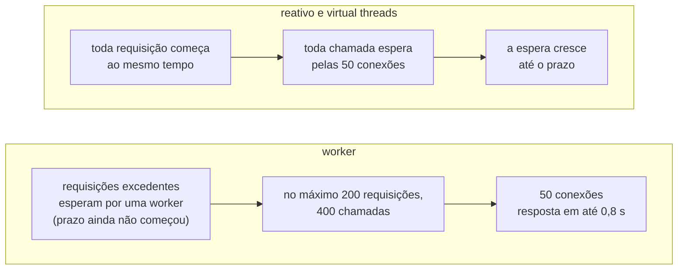
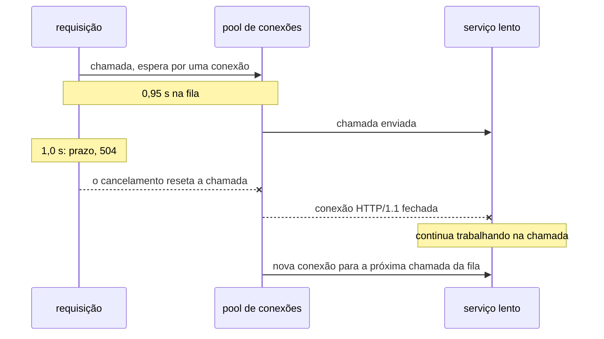

Faça um benchmark dos três modelos do jeito rápido e você ganha uma tabela limpa. O jeito rápido é um gerador de carga no seu modo fechado de sempre, em que cada usuário virtual espera a resposta antes de enviar a próxima requisição, e cada modelo escrito no seu formato mais natural. Esta tabela vem de uma das primeiras execuções do demo, no cenário que chama um serviço HTTP lento duas vezes por requisição, com o pool de conexões ampliado para não atrapalhar:

| Modelo | Requisições/s | Latência mediana (p50) |
|---|---|---|
| worker threads | 988 | 403 ms |
| virtual threads | 1.964 | 202 ms |
| reativo | 3.928 | 101 ms |

Virtual threads duas vezes mais rápidas que workers, reativo quatro vezes. Uma tabela assim vai parar em slides, e ela mede duas coisas que não são os modelos.

A primeira é o gerador de carga. Aqui ele rodou 400 usuários virtuais em loop. Com 400 usuários e latência de 200 ms, o máximo que ele consegue medir é 400 / 0,2 s = 2.000 requisições por segundo; com 100 ms, 4.000. As linhas de virtual threads e de reativo são o número de usuários dividido pela latência.

A linha das workers é a única que chegou ao limite do servidor. Ali, 200 worker threads, cada uma ocupada por cerca de 200 ms, limitam o throughput a 1.000 requisições por segundo, e os usuários excedentes esperaram numa fila, o que dobrou a latência para 403 ms. Mesmo esse número esconde algo: num modelo fechado, um servidor lento desacelera junto o gerador de carga, então as requisições que mais esperariam nem chegam a ser enviadas. Isso é coordinated omission, contra o qual o [guia de performance do Quarkus](https://quarkus.io/guides/performance-measure) alerta, e que o paper DEBS 2023 sobre virtual threads no Quarkus evitou com um gerador de carga de modelo aberto, que envia requisições numa taxa fixa seja qual for a resposta do servidor.

A segunda é o código. No seu formato natural, a worker e a virtual thread chamam o serviço duas vezes seguidas, enquanto a variante reativa combina as duas chamadas para que se sobreponham, e cada modelo limita a espera com um mecanismo diferente. A diferença entre 202 e 101 ms é o formato do código, não o modelo. Um benchmark de modelos precisa dar o mesmo trabalho a todos, e o demo tem um teste que falha quando isso não acontece: o `FanOutTest` exige que todo endpoint do benchmark responda em menos de 600 ms contra um serviço de 300 ms, o que duas chamadas seguidas não conseguem.

Esta última parte da série é sobre a pergunta que todo mundo faz depois das três primeiras: **reativo ou virtual threads?** Ela responde no Quarkus 4, com um benchmark que evita as duas armadilhas, e com uma conclusão diferente daquela primeira tabela. Na maioria das aplicações, não é o modelo que define o limite; é um pool. E quando o limite é o pool na frente de um serviço lento, o worker pool que as virtual threads removem é o que impede uma sobrecarga de virar uma onda de falhas.

## O laboratório

O [demo](https://github.com/omatheusmesmo/demos/tree/main/quarkus/reactive-core) expõe cada cenário nos três modelos: um método síncrono numa worker, um `Uni` no event loop e um método síncrono com `@RunOnVirtualThread`. Os testes citados aqui passam na 3.40.1 e na 4.0.0.Beta1 do Quarkus, com Java 25. O benchmark rodou nas duas versões, e os scripts e as tabelas de resultados estão no repositório.

## 1. Como o Quarkus roda uma virtual thread

Um framework construído sobre o Netty poderia adotar virtual threads de vários jeitos. O paper DEBS 2023 de Arthur Navarro, Julien Ponge, Frédéric Le Mouël e Clément Escoffier descreve os três que o time do Quarkus considerou:

| Estratégia | Resultado |
|---|---|
| Manter o modelo de workers, com uma virtual thread por tarefa no lugar de uma worker do pool | escolhida |
| Usar os event loops como carrier threads | descartada: risco de deadlock |
| Mudar o Netty para os event loops rodarem em virtual threads | descartada: invasiva demais |

A segunda opção é a tentadora, porque evitaria trocar de thread. Uma carrier é a platform thread em que uma virtual thread roda enquanto está montada. O paper explica por que os event loops não podiam ser carriers: "It appeared that when a carrier thread shares locks with virtual threads it might cause a deadlock situation." Uma virtual thread montada num event loop poderia esperar por algo que só aquele event loop consegue fazer, enquanto o event loop espera a virtual thread desmontar.

Então um método `@RunOnVirtualThread` segue o mesmo caminho de um método bloqueante: a requisição chega num event loop, e o Quarkus entrega o trabalho a uma virtual thread nova em vez de uma worker do pool. A parte 2 mostrou o que vem junto: o método roda no duplicated context da requisição, os filtros normais rodam na mesma virtual thread, e a thread se chama `quarkus-virtual-thread-*`. As carriers são o próprio `ForkJoinPool` do JDK, com uma carrier por CPU por padrão.

Isso também fecha a história que a parte 1 deixou em aberto. Lá, o `await()` num event loop falhava na hora: o Mutiny pergunta ao Quarkus se a thread atual pode ser bloqueada, e num event loop a resposta é não. Numa virtual thread a resposta é sim, e o mesmo `await()` retorna normalmente. Bloquear uma virtual thread não bloqueia a carrier dela: a virtual thread desmonta, e a carrier passa a rodar outra.

O que muda no Quarkus 4 é como esse código é escrito. O Quarkus 3 ainda suportava Java 17, então o suporte a virtual threads não podia chamar a API do Java 21 diretamente. O [quarkusio/quarkus#56328](https://github.com/quarkusio/quarkus/pull/56328), integrado para a 4.0.0.Beta1, removeu essa camada agora que o Java 21 é a versão mínima:

```diff
-        Method ofVirtual = Thread.class.getMethod("ofVirtual");
-        Object vtb = ofVirtual.invoke(VirtualThreadsRecorder.class);
+        Thread.Builder.OfVirtual builder = Thread.ofVirtual();
```

O post de Clément Escoffier sobre o Java 21 como versão mínima dá o motivo numa frase: com reflection, "virtual threads felt like second-class citizens; not every extension was tested with them."

## 2. O que mudou por baixo

O mesmo paper é também a melhor explicação para os resultados de 2023 que diziam que "virtual threads são mais lentas no Quarkus". Ele mediu o Quarkus no JDK 19, quando virtual threads ainda estavam em preview, em containers com meia CPU e 512 MB. Num primeiro teste, as virtual threads atenderam cerca de um quarto das requisições da pilha reativa num benchmark de JSON. A causa não eram as virtual threads em si:

> the way Netty was using ThreadLocals put much pressure on the Garbage Collector, especially during serialization

Depois que o Netty passou a depender menos de `ThreadLocal`, a diferença quase sumiu. Uma análise de heap encontrou então o próximo culpado, o reciclador de buffers do Jackson, que também guarda os buffers em `ThreadLocal`s: dois na pilha reativa, um por event loop, e milhares por segundo com uma virtual thread por requisição. A conclusão dos autores é precisa: "virtual threads are not directly responsible for the high memory consumption". O alerta que eles tiram disso vale muito além do Quarkus: "the integration of virtual threads in frameworks built on top of Netty or that rely heavily on ThreadLocals, presuming a small thread count, is likely to experience significant garbage collection (GC) pressure".

O Quarkus não esperou o Jackson mudar. Desde o início de 2024 ([quarkusio/quarkus#38196](https://github.com/quarkusio/quarkus/pull/38196) e [#39739](https://github.com/quarkusio/quarkus/pull/39739)), a extensão do Jackson troca o reciclador padrão pelo `HybridJacksonPool` do Vert.x, que mantém o pool de `ThreadLocal` para platform threads e dá às virtual threads um pool lock-free dividido em uma faixa por CPU. O Quarkus 4 traz o Jackson 3, cujo padrão próprio não usa mais `ThreadLocal`: no `jackson-core` 2.21.7 o `defaultPool()` devolve `threadLocalPool()`, e no 3.1.4 devolve `newConcurrentDequePool()`. O Quarkus 4 continua instalando o pool híbrido, por meio de uma variante para o Jackson 3 que o Vert.x 5 traz.

O Quarkus 4 passa para o Netty 4.2, cujo guia de migração torna padrão um novo alocador de memória e diz que ele "was also designed from the start to work well with virtual threads". O paper e o guia apontam na mesma direção: menos estado associado a cada thread. Ligar os dois é leitura minha; nenhum dos documentos cita o outro.

O reciclador do Jackson baseado em `ThreadLocal` apareceu de novo em 2026. O post de Francesco Nigro [To Cache or Not to Cache Virtual Threads](https://quarkus.io/blog/to-cache-or-not-to-cache-virtual-threads/) foi revisado a fundo em 11 de setembro, depois que uma pergunta de um revisor do OpenJDK revelou um bug no próprio benchmark: o reciclador padrão do Jackson retinha um conjunto de buffers por virtual thread, cerca de 200 MB de heap vivo nas execuções com pool. Todos os números foram medidos de novo. O conselho de não usar pool de virtual threads continua valendo, o pool ganha por pouco menos de 3% com heap de 4 GB, e a explicação original do colapso em heaps pequenos por churn de `StackChunk` foi retirada: o colapso agora é "reported, not explained".

## 3. O limite costuma ser um pool

O [Guia de Bolso de Virtual Threads](/posts/guia-de-bolso-virtual-threads/) usou a lei de Little para explicar por que virtual threads existem: concorrência = throughput x latência. Lida ao contrário, ela diz o máximo que um pool consegue atender: **throughput = concorrência / latência**. Todo modelo no Quarkus passa por pools, e cada um tem um padrão:

| Pool | Padrão | Quem passa por ele |
|---|---|---|
| Event loops | um por CPU, no mínimo 2 (parte 1) | toda requisição; o próprio trabalho do modelo reativo |
| Worker threads | `max(8 x CPUs, 200)` | endpoints e consumers bloqueantes |
| Virtual threads | sem limite | `@RunOnVirtualThread` |
| Conexões JDBC (Agroal) | 50 | Hibernate ORM, em workers e virtual threads |
| Conexões SQL reativas | 20 | Hibernate Reactive |
| Conexões do REST Client | 50 por cliente | todo modelo que chama um serviço HTTP |
| Messaging, consumers em virtual threads | 1.024 por método | consumers com `@RunOnVirtualThread` |

Esgotar o pool não significa a mesma coisa em todas as linhas. Uma requisição que precisa de uma conexão JDBC espera até 5 segundos por uma (`quarkus.datasource.jdbc.acquisition-timeout`) e então falha. Uma requisição que precisa de uma conexão SQL reativa espera numa fila sem limite de tamanho por até 30 segundos, o padrão do Vert.x, que o Quarkus 4 agora expõe como `quarkus.datasource.reactive.connection-timeout`, ao lado de `quarkus.datasource.reactive.max-wait-queue-size` para o tamanho da fila. O mesmo banco, na mesma sobrecarga, falha rápido numa pilha e enfileira na outra, e nenhuma das duas coisas é propriedade do modelo.

Virtual threads removem exatamente uma linha dessa tabela, a das worker threads. O demo tem um teste para cada lado dessa afirmação.

O `ConcurrencyTest` limita o worker pool a quatro threads e dispara doze requisições num endpoint que chama um serviço lento. A variante worker nunca tem mais de quatro requisições em andamento; as variantes reativa e de virtual threads atendem as doze de uma vez.

O `PoolLimitTest` mantém as virtual threads e, em vez disso, limita o pool JDBC a quatro conexões. Doze requisições rodam ao mesmo tempo, como antes, mas as métricas do Agroal mostram que só quatro conexões chegaram a ser usadas: as outras oito virtual threads esperavam por uma. O limite saiu das threads e foi para as conexões.

O messaging acrescenta o seu próprio limite. Um consumer `@RunOnVirtualThread` processa até 1.024 mensagens de uma vez por método, e o `ConcurrencyLimitTest` mostra que a chave para mudar isso, `smallrye.messaging.worker.<virtual-thread>.max-concurrency`, é literal: os sinais de menor e maior fazem parte do nome. O mesmo consumer também abre mão da ordem das mensagens: três pedidos que levam 300, 200 e 100 ms terminam como `[3, 2, 1]`, enquanto os consumers no event loop e com `@Blocking` mantêm `[1, 2, 3]`. Escolher virtual threads para um consumer muda a semântica dele, não só a thread.

## 4. O benchmark

Em resumo:

- abaixo de todos os limites, os três modelos dão os mesmos números;
- com um pool de conexões largo o bastante para não atrapalhar, o worker pool é o teto, e virtual threads e reativo passam dele;
- com o pool padrão do REST Client, o mesmo teto protege: a worker continua atendendo na capacidade do pool enquanto as outras duas colapsam;
- no cenário de banco, a diferença vem dos tamanhos padrão dos pools, não dos modelos.

### Como foi medido

A montagem segue o [guia de performance do Quarkus](https://quarkus.io/guides/performance-measure) e o laboratório que o Quarkus usa para se comparar com o Spring, o [`quarkusio/spring-quarkus-perf-comparison`](https://github.com/quarkusio/spring-quarkus-perf-comparison):

| Item | Valor |
|---|---|
| Carga | [Hyperfoil](https://hyperfoil.io/) 0.29.3 em modelo aberto: uma taxa de chegada fixa, com intervalos iguais, seja qual for a resposta do servidor. Ele mantém em andamento no máximo tantas requisições quanto 10 s da taxa, e nunca mais de 5.000; uma requisição agendada enquanto todas estão ocupadas não é enviada, e os resultados a contam como não enviada. O cliente desiste depois de 10 s |
| Aplicação | 2 CPUs (`cpuset` e `-XX:ActiveProcessorCount=2`), um container de 1 GB, heap de 512 MB com `Xms` igual a `Xmx`, ParallelGC, a mesma imagem `ubi9/openjdk-25-runtime` nas duas versões |
| Iterações | 3 por variante, cada uma numa JVM nova: 2 minutos de aquecimento, 30 s de pausa, depois 30 s por taxa de chegada |
| Métricas | respostas 2xx por segundo na fase inteira, latência medida pelo Hyperfoil, memória residente (RSS) pelo `docker top`, CPU pelo cgroup do container; cada valor é a mediana das 3 iterações |
| Máquina | AMD Ryzen 5 5600GT, 12 CPUs lógicas; o gerador de carga e as dependências rodam em outros núcleos |

Entre as duas versões, muda mais do que o Quarkus: o Vert.x vai de 4.5.34 para 5.1.8, o Netty de 4.1.138 para 4.2.18 e o Jackson de 2.21.7 para 3.1.4.

São quatro cenários, cada um varrido em torno da capacidade que a lei de Little prevê:

| Cenário | Trabalho por requisição | Limite previsto |
|---|---|---|
| fan-out | duas chamadas simultâneas a um serviço de 100 ms, sob um prazo único de 1 s, pool padrão do REST Client | 50 conexões / 0,1 s / 2 chamadas = **250 req/s** em todos os modelos |
| fan-out, pool largo | o mesmo, com 1.000 conexões | 200 workers / 0,1 s = **2.000 req/s** para a worker; nenhum, na faixa medida, para os outros |
| banco | uma query de 200 ms, pools padrão | JDBC: 50 / 0,2 s = **250 req/s**; reativo: 20 / 0,2 s = **100 req/s** |
| cpu | uma quantidade fixa de hashing SHA-256, sem I/O | as 2 CPUs |

Os endpoints de fan-out são os que a introdução prometeu: todos os modelos disparam as duas chamadas ao mesmo tempo e falham pelo mesmo prazo, e o `FanOutTest` e o `FanOutDeadlineTest` falham se isso deixar de ser verdade.

Nas tabelas abaixo, a primeira coluna é a taxa oferecida pelo gerador de carga, e cada célula é o que a variante atendeu: respostas 2xx por segundo, a mediana de 3 execuções.

### Abaixo dos limites, os modelos são iguais

No Quarkus 4, a 100 e a 200 req/s no fan-out, as três variantes respondem com mediana de 101 ms. Com o pool largo, até 1.500 req/s, o mesmo. No cenário de CPU, até 1.500 req/s, a mediana é de 1 ms e as três ocupam entre 1,56 e 1,61 das suas duas CPUs. Longe de qualquer limite, as medianas não distinguem os modelos; só a cauda distingue, e pouco: a 1.500 req/s de trabalho de CPU, o p99 é de 8 ms na worker, 9 ms no reativo e 26 ms nas virtual threads.

### O pool largo: o worker pool é o teto

| Fan-out, pool largo, req/s oferecidas | worker | reativo | virtual |
|---|---|---|---|
| 1.500 | 1.494 | 1.494 | 1.494 |
| 2.500 | 1.961 | 2.490 (p50 101 ms) | 2.490 (p50 101 ms) |
| 4.000 | 1.968 | 3.985 | 3.985 |

*Quarkus 4.0.0.Beta1. Na 3.40.1 a worker para em 1.976 e 1.973, e as outras duas diferem destas em no máximo uma requisição por segundo.*

Este é o resultado para o qual as virtual threads foram feitas. A variante worker para nas 2.000 req/s que as suas 200 threads permitem. As variantes virtual thread e reativa fazem as mesmas chamadas sem esse teto e chegam a 4.000 req/s sem nenhum erro. A 4.000 req/s, a variante reativa ocupou 0,73 de uma CPU e a de virtual threads 0,93 (0,53 e 0,88 na 3.40.1).

Depois do teto da worker, o próprio gerador de carga virou um limite. As requisições esperando por uma worker ocuparam as suas 5.000 vagas, e ele deixou de enviar 11.221 das 75.000 requisições agendadas a 2.500 req/s, e 55.864 das 120.000 a 4.000. O teto continua valendo, mas a mediana de 2,5 s da worker nessas taxas só diz quanto tempo 5.000 requisições na fila levam para escoar a 2.000 por segundo. Com todas as requisições enviadas, a fila por uma worker continuaria crescendo até os 10 s de timeout do cliente.

### O pool padrão: um teto que protege

Com o pool padrão do REST Client, os mesmos endpoints contam a história oposta:

| Fan-out, pool padrão, req/s oferecidas | worker | reativo | virtual |
|---|---|---|---|
| 200 | 199 | 199 | 199 |
| 300 | **248**, sem erros (p50 3,2 s) | 44, 85% de erros | 44, 85% de erros |
| 400 | 163, 46% de erros | 19, 95% de erros | 19, 95% de erros |

*Quarkus 4.0.0.Beta1. Na 3.40.1, todos os números diferem destes em no máximo uma requisição por segundo.*

As três batem no mesmo pool a 250 req/s. A variante worker atende 248, o máximo que esse pool permite, enquanto as outras duas caem para 44. Toda falha delas é um `5xx` enviado quando o 1 s acabou; nenhuma é timeout do cliente.

A diferença está em onde as requisições excedentes esperam. Na variante worker, no máximo 200 requisições rodam ao mesmo tempo, então no máximo 400 chamadas estão esperando pelas 50 conexões ou usando uma delas, e as conexões completam 500 chamadas por segundo. A fila atende por ordem de chegada, então uma chamada que entra nela é respondida em no máximo 400 / 500 = 0,8 s, abaixo do prazo. As outras requisições esperam por uma worker, antes de o método começar e, com ele, o prazo. A latência delas cresce, para 3,2 s na mediana, mas toda requisição que começa termina a tempo. A 400 req/s, a fila por uma worker passa dos 10 s de timeout do cliente, e esses são os 46%.

Nas variantes reativa e virtual thread, nada limita quantas chamadas esperam por uma conexão.



Quando essa espera chega perto de 1 s, uma chamada sai da fila a tempo de ser enviada e a resposta dela chega depois que a requisição já falhou. O `FanOutOverloadTest` reproduz isso numa escala menor: 5 conexões, 10 workers, um serviço de 100 ms e 30 requisições por segundo onde cabem 25. A variante worker atende as 300 requisições, e o serviço recebe exatamente as 600 chamadas delas. As variantes reativa e de virtual threads atendem entre 110 e 122, nas duas versões, e o serviço ainda recebe as 600 chamadas. A maior parte do trabalho dele responde a requisições que já falharam.



A última parte desse diagrama piora tudo. Cancelar uma chamada que já foi enviada a reseta, e no HTTP/1.1 o Vert.x fecha a conexão para isso (`Http1ClientConnection.reset` no Vert.x 5, `Http1xClientConnection.reset` no Vert.x 4). O pool abre uma conexão nova para a próxima chamada enquanto o serviço ainda está ocupado com a abandonada, e no `FanOutOverloadTest` o serviço recebe até 62 chamadas por segundo, mais do que as 50 que 5 conexões deveriam dar conta. O cancelamento em si funciona: uma chamada cancelada enquanto ainda espera por uma conexão nunca é enviada. No `CancelledCallTest`, vinte chamadas dividem uma conexão com um serviço de 300 ms, e no máximo cinco chegam a ele, quando a fila teria escoado as vinte em seis segundos. O desperdício vem das chamadas que saem da fila só um pouco tarde demais.

Esse é o outro lado do "virtual threads removem exatamente uma linha" da seção 3. O worker pool é um teto, e também é um bulkhead: um limite de quantas requisições podem estar dentro de uma parte do sistema ao mesmo tempo, para que uma sobrecarga faça fila na frente dela e não dentro dela. Virtual threads e `Uni` o removem, e com ele a única coisa que mantinha a fila por uma conexão mais curta que o prazo. Sem ele, outra coisa precisa limitar quantas chamadas esperam pelo pool, como um bulkhead na frente da chamada (`@Bulkhead` do MicroProfile Fault Tolerance, que o Quarkus implementa com o SmallRye Fault Tolerance). Não fiz benchmark dessa alternativa.

### O banco: um padrão, não um modelo

| Banco, req/s oferecidas | worker | reativo | virtual |
|---|---|---|---|
| 100 | 99 (p50 202 ms) | 98 (p50 329 ms) | 99 (p50 202 ms) |
| 200 | 199 | **48**, 68% de erros | 199 |
| 300 | 247 (p50 3,3 s) | 32, 86% de erros | 247, 3,4% de erros |

*Quarkus 4.0.0.Beta1. Na 3.40.1, todos os números diferem destes em no máximo duas requisições por segundo.*

A variante reativa falha a 200 req/s porque o pool dela tem 20 conexões, ou seja, 100 queries de 200 ms por segundo, e a 100 req/s ela já está enfileirando (329 ms na mediana). O pool JDBC tem 50. Isso é um padrão de configuração, e o `AbandonedQueryTest` mostra que não é o modelo. Ele dá 5 conexões a cada pool e 20 threads ao worker pool, e pede o dobro do que as conexões atendem: 500 requisições de clientes que desistem depois de 2 s. Todas as variantes passam a responder menos de 100 das 500 requisições e executam de três a seis vezes mais queries do que respondem: todas continuam consultando o banco para clientes que já foram embora.

| Variante | respondidas | métodos executados | queries executadas | banco ocupado depois que o último cliente desistiu | o que limita |
|---|---|---|---|---|---|
| worker | 92 | 313 | 314 | 0,8 s | uma requisição que ainda espera por uma worker é descartada quando o cliente vai embora |
| virtual | 74 | 500 | 382 | 3,1 s | o timeout de aquisição de 5 s do Agroal |
| reativo | 75 | 500 | 425 | 8,6 s | nada antes do connection timeout de 30 s: a fila de espera não tem limite de tamanho |

*Quarkus 4.0.0.Beta1. Na 3.40.1, todos os números diferem destes em no máximo 3, e as caudas são as mesmas.*

É na duração do desperdício que as pilhas diferem. Uma requisição que ainda espera por uma worker quando o cliente desiste nunca roda: o cliente fecha a conexão, e o Quarkus REST confere a conexão antes de invocar o método. Só as 20 requisições que já estão numa worker continuam consultando o banco. Isso depende de o cliente fechar a conexão: atrás de um proxy que mantém aberta a própria conexão com a aplicação, as requisições na fila rodariam mesmo assim. Toda requisição em virtual thread começa na hora e espera por uma conexão JDBC, até o Agroal desistir depois de 5 s. No benchmark, os 3,4% de erros da variante virtual thread a 300 req/s são esses timeouts, respondidos como `500`, e o p99 dela é de 5,2 s, o timeout mais a query. Toda requisição reativa também começa na hora, e a fila do pool reativo não tem limite de tamanho, então ele continua enviando queries que ninguém vai ler.

### CPU: nada a ganhar

| CPU, req/s oferecidas | worker | reativo | virtual |
|---|---|---|---|
| 1.500 | 1.499 (p99 8 ms) | 1.499 (p99 9 ms) | 1.499 (p99 26 ms) |
| 2.000 | 1.864 (p99 3,7 s) | 1.826 (p99 3,4 s) | 1.750 (p99 7,2 s) |

*Quarkus 4.0.0.Beta1. Na 3.40.1, a 2.000 req/s: 1.745, 1.717 e 1.701. A 2.000 req/s o gerador de carga ficou sem vagas em algumas execuções e deixou de enviar até 5.006 das 60.000 requisições, então os p99 dessa taxa são limites inferiores.*

Com duas CPUs e sem I/O, as CPUs são o limite, e nenhum modelo cria CPU. Na saturação, a variante virtual thread atendeu menos requisições e teve o pior p99 no Quarkus 4; na 3.40.1, as três ficaram a menos de 3% de diferença entre si.

### Quarkus 4 contra 3.40.1

As duas versões têm o mesmo formato: os mesmos tetos, nas mesmas taxas, e os mesmos colapsos. Duas diferenças chamam atenção. Nos cenários de fan-out em taxas altas, o Quarkus 4.0.0.Beta1 usou mais CPU e mais memória: a 4.000 req/s com o pool largo, a variante reativa ocupou 0,73 de uma CPU e chegou a 621 MiB de RSS, contra 0,53 e 411 MiB na 3.40.1, com 305 ms de pausas de GC contra 206 ms. No cenário de banco a 300 req/s, ele usou mais memória, mas menos CPU. No cenário de CPU, na saturação, o Quarkus 4 atendeu mais: 1.864, 1.826 e 1.750 requisições por segundo, contra 1.745, 1.717 e 1.701.

Não isolei a causa. Entre as duas imagens, Vert.x, Netty e Jackson mudam de versão major ao mesmo tempo, e a 4.0.0.Beta1 é uma beta. Os números de CPU também são só os do container: a 4.000 req/s, as CPUs da aplicação gastaram até 0,7 de uma CPU a mais em trabalho que o cgroup do container não conta, e essa parcela variou bastante entre execuções e versões. Esses números dizem o que medir na sua própria aplicação quando a versão final sair, não por que mudou.

## 5. Uma auditoria de pinning, por integração

O Guia de Bolso cobriu o que é pinning e o que ainda causa pinning no Java 25. O demo acrescenta a pergunta que importa para uma aplicação Quarkus: o caminho de código de cada extensão causa pinning? Todo caminho em virtual thread roda sob `@VirtualThreadUnit` com `@ShouldNotPin`, do artefato `junit-virtual-threads`, que observa os eventos de pinning do JFR.

| Integração | Caminho | Causa pinning? |
|---|---|---|
| Endpoint REST | método `@RunOnVirtualThread` | não |
| REST Client | chamada `Uni` aguardada com `await().atMost()` | não |
| PostgreSQL | Hibernate ORM e o driver JDBC | não, depois da primeira chamada |
| Redis | cliente Redis bloqueante, que espera numa conexão do Vert.x | não |
| Kafka | consumer `@RunOnVirtualThread` | não |
| Scheduler | job `@RunOnVirtualThread` | não |
| Seu código | um inicializador estático que bloqueia | **sim**, com `@ShouldPin` |

Dois detalhes apareceram ao escrever esses testes. A primeira chamada JDBC numa virtual thread pode causar pinning uma vez. Rodando isolada, ela fez o JFR registrar um evento de pinning com o motivo "Waited for initialization of sun.nio.ch.Poller by another thread": a primeira leitura bloqueante de socket faz o JDK inicializar o seu poller de I/O, e esperar pela inicialização de uma classe causa pinning. Depois de uma requisição de aquecimento, o caminho do PostgreSQL fica limpo. Um inicializador estático seu que bloqueia ainda causa pinning na virtual thread que o executa, no Java 25 como antes.

O segundo detalhe é sobre os próprios testes: o `@ShouldNotPin` passa quando nada roda em virtual thread nenhuma. Descobri isso ao tirar o `@RunOnVirtualThread` de um endpoint; o teste de pinning continuou verde. Todo teste de pinning do demo agora também verifica que uma virtual thread atendeu a requisição.

## 6. Escolhendo

| Se o seu código | Prefira | Porque |
|---|---|---|
| chama bibliotecas bloqueantes (JDBC, Hibernate ORM, clientes bloqueantes) e precisa atender muitas requisições concorrentes | virtual threads | código bloqueante, sem o worker pool como teto |
| chama um serviço HTTP sob um prazo, e pode receber mais do que o pool de conexões dele atende | worker threads, ou um limite seu na frente do pool | o worker pool funciona também como bulkhead; virtual threads e `Uni` deixam toda requisição esperar pelo pool até o prazo (seção 4) |
| já é construído sobre clientes reativos (Hibernate Reactive, o REST Client reativo, clientes do Vert.x) | reativo | sem salto de thread, e o menor uso de CPU com o mesmo throughput no fan-out HTTP do benchmark; dimensione você mesmo o pool SQL reativo e a fila de espera dele |
| faz trabalho intensivo em CPU | worker threads | virtual threads não acrescentam nada, e trabalho longo de CPU em poucas carriers deixa outras virtual threads sem vez |
| faz pouco trabalho por requisição e nenhum I/O bloqueante | o event loop (`@NonBlocking` ou um `Uni`) | nenhum salto de thread |
| consome mensagens cuja ordem importa | `@Blocking` ou o event loop | consumers `@RunOnVirtualThread` processam de forma concorrente e perdem a ordem |
| guarda estado em `ThreadLocal`, seu ou de uma biblioteca | meça antes | uma virtual thread por requisição transforma um cache por thread numa alocação por requisição |

E seja qual for o modelo, encontre o pool na frente do seu gargalo antes de trocar de modelo. Aumentar o `quarkus.datasource.jdbc.max-size` ou o pool do REST Client pode fazer mais do que trocar workers por virtual threads, e trocar sem aumentá-los pode não mudar nada.

## Conclusão

Aqui termina a série. Por baixo do Quarkus há poucos event loops (parte 1); o Quarkus decide em build time qual thread começa o seu método (parte 2); o Mutiny roda uma receita quando alguém faz a subscription, na thread que emitir (parte 3); e no Quarkus 4 os três modelos rodam numa pilha cujo Java 21 como versão mínima permite chamar virtual threads diretamente, sobre versões do Netty e do Jackson que guardam menos estado por thread (parte 4). Se isso compensa ainda precisa ser medido na versão final.

A pergunta "reativo ou virtual threads?" tem uma resposta menos empolgante do que a primeira tabela prometia. Os dois removem o worker pool como teto, e com ele um bulkhead do qual você talvez dependesse sem saber. Nenhum remove os pools na frente do seu banco ou dos serviços que você chama, e a lei de Little diz onde estão esses tetos antes de qualquer benchmark. O modelo decide o formato do seu código e como ele se comporta além de um limite; os pools decidem o seu throughput. E todo número que você lê, inclusive os meus, vale tanto quanto a forma como foi medido.

## Recursos

- [Demo: `quarkus/reactive-core`](https://github.com/omatheusmesmo/demos/tree/main/quarkus/reactive-core): `integrations/*` (`ConcurrencyTest`, `PoolLimitTest`, `ConcurrencyLimitTest`, `ConsumersTest`, `FanOutTest`, `FanOutOverloadTest`, `CancelledCallTest`, `AbandonedQueryTest`, os testes de pinning) e `benchmark/` com os scripts e os resultados
- [Measuring performance](https://quarkus.io/guides/performance-measure), o guia do Quarkus que o benchmark segue, e o [`quarkusio/spring-quarkus-perf-comparison`](https://github.com/quarkusio/spring-quarkus-perf-comparison)
- Arthur Navarro, Julien Ponge, Frédéric Le Mouël, Clément Escoffier. [Considerations for integrating virtual threads in a Java framework: a Quarkus example in a resource-constrained environment](https://doi.org/10.1145/3583678.3596895). DEBS 2023
- [Java 21: the foundation for Quarkus 4](https://quarkus.io/blog/java21/), Clément Escoffier
- [Netty 4.2 Migration Guide](https://github.com/netty/netty/wiki/Netty-4.2-Migration-Guide)
- [To Cache or Not to Cache Virtual Threads](https://quarkus.io/blog/to-cache-or-not-to-cache-virtual-threads/), Francesco Nigro (revisado em setembro de 2026)
- [Virtual thread support reference](https://quarkus.io/guides/virtual-threads) e [Virtual threads with Reactive Messaging](https://quarkus.io/guides/messaging-virtual-threads)
- Antes nesta série: [parte 1](/posts/quarkus-event-loop-do-zero/), [parte 2](/posts/quarkus-quem-roda-o-seu-codigo/) e [parte 3](/posts/mutiny-uni-receita-nao-resultado/); e o [Virtual Threads: Guia de Bolso](/posts/guia-de-bolso-virtual-threads/)
